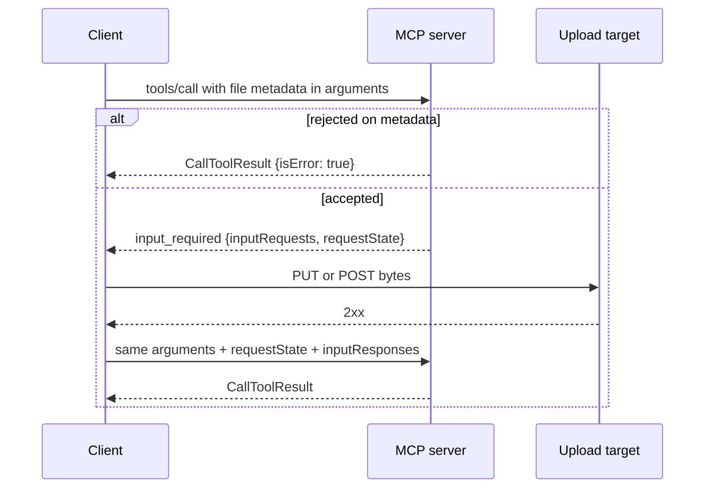

# File Uploads Extension

- **Status**: Experimental draft, not yet proposed as a SEP
- **Extension Identifier**: `io.modelcontextprotocol/files` (provisional)
- **Working Group**: [File Uploads](https://modelcontextprotocol.io/community/working-groups/file-uploads)
- **Editors**: Den Delimarsky (@localden)
- **Discussion**: [File Uploads Working Group Discord thread](https://discord.com/channels/1358869848138059966/1551968557292593172/1552399008440520865)
  and issues in this repository

This draft uses SEP form so the working group can submit it as an Extensions Track SEP once a
reference implementation exists. Anything here, including the extension identifier, can change
before then.

## Abstract

This extension lets a client send a file to a tool, and receive a file from one, without passing a
large file's bytes through the model or a JSON-RPC message. A server marks file arguments with the
`x-mcp-file` keyword first proposed in
[SEP-2356](https://github.com/modelcontextprotocol/modelcontextprotocol/pull/2356). The client calls
the tool with the file's metadata in the file argument, with optional base64 `data`. If `data` is
absent, the server can reject the call on the metadata or request an upload to an HTTPS target. The
client uploads the bytes and retries with the same arguments and a per-file outcome. A tool returns
a file by listing a download target in the result's `_meta`.

This revision covers uploads and downloads. [Future Work](#future-work) lists chunked and resumable
uploads and file fields in elicitation forms.

## Motivation

MCP has no interoperable way to get a file from a user to a tool. The existing options
(`EmbeddedResource`, `BlobResourceContents`, base64 strings in arguments) put the bytes inside a
JSON-RPC message. When the model emits tool arguments as tokens, the bytes pass through its
context window, and large uploads to remote MCP servers fail.

The File Uploads Working Group collected the cases this blocks at its
[October 2, 2026 meeting](https://github.com/modelcontextprotocol/modelcontextprotocol/discussions/3412):

- A user asks an assistant to save a 40 MB PDF from the conversation into a cloud-storage folder.
- An agent pulls a 200 MB CSV into its code sandbox.
- An agent uploads a 50 MB deck as a new revision of an existing document and keeps the link.
- An enterprise agent uploads or downloads on a user's behalf, with or without the user present,
  to one of many sites or drives, so the call that returns an upload target has to carry the
  destination.

The same meeting recorded the host-side constraints:

- One model turn per upload.
- File contents and credentials never enter the context window.
- Small files stay in band to keep latency down.
- Large files go out of band to avoid base64.
- Uploads work when a gateway holds the OAuth credentials instead of the host.
- File pointers on the wire carry a marker a deterministic proxy can find.

[SEP-2356](https://github.com/modelcontextprotocol/modelcontextprotocol/pull/2356) defined how a
server declares a file argument and an inline `data:` encoding, and sent larger files to URL-mode
elicitation instead of defining an upload protocol. It closed without merging.
[SEP-2631](https://github.com/modelcontextprotocol/modelcontextprotocol/pull/2631) added out-of-band
transfer through new `files/authorizeUpload` and `files/authorizeDownload` methods. Thomas Sarlandie
identified ordering as the main problem in SEP-2631. Bytes move before the server sees the rest of
the call, so uploads that permissions, quota, or data residency rules would reject still consume
bandwidth and can land in the wrong region. The group agreed on metadata first, then the upload
target, then bytes, then finalize, and agreed to build on multi round-trip requests (MRTR) and
existing primitives before adding new ones.

## Specification

The key words "MUST", "MUST NOT", "REQUIRED", "SHALL", "SHALL NOT", "SHOULD", "SHOULD NOT",
"RECOMMENDED", "NOT RECOMMENDED", "MAY", and "OPTIONAL" in this document are to be interpreted as
described in [BCP 14](https://datatracker.ietf.org/doc/html/bcp14)
[[RFC2119](https://datatracker.ietf.org/doc/html/rfc2119)]
[[RFC8174](https://datatracker.ietf.org/doc/html/rfc8174)] when, and only when, they appear in all
capitals, as shown here.

In this document, _client_ is the component that speaks MCP to the next hop, which can be a server
or a gateway. A host behind a gateway is a client of that gateway, and the gateway is a client of
the server. _Host_ is the application that presents the model and the user interface. _MCP address_
is the URL a client sends MCP requests to, so it can differ per hop and can differ from the server's
canonical URI. Requirements on clients in [Transfer](#transfer), [Transfer
Targets](#transfer-targets), and [Downloads](#downloads) bind the component that performs the
transfer.

This revision applies to tools. Resources keep their base protocol behavior.

### Extension Identifier

This extension uses the identifier `io.modelcontextprotocol/files`.

### Negotiation

Clients **MUST** declare the extension in the `io.modelcontextprotocol/clientCapabilities` request
metadata of every request that may need it:

```json
{ "extensions": { "io.modelcontextprotocol/files": { "upload": {}, "download": {} } } }
```

Servers advertise extension support in the `server/discover` response:

```json
{
  "capabilities": {
    "tools": {},
    "extensions": {
      "io.modelcontextprotocol/files": {
        "upload": {},
        "download": {},
        "maxInlineBytes": 1048576
      }
    }
  }
}
```

The settings object has the following fields:

- `upload` _(optional)_: The sender supports out-of-band uploads.
- `download` _(optional)_: The sender supports out-of-band downloads.
- `maxInlineBytes` _(optional, servers only)_: The largest total decoded size of inline `data`
  values the server accepts in one request.

A missing `upload` or `download` field means that direction is not supported. Receivers **MUST**
ignore fields they do not recognize.

Clients **MUST NOT** use this extension with a server that did not advertise it.

A server that accepts inline `data` **MUST** advertise `maxInlineBytes`. If `maxInlineBytes` is `0`
or missing, the server does not accept inline transfer. Clients **MUST NOT** send a request whose
inline `data` values exceed `maxInlineBytes` in total, and **MUST** omit `data` from every file
argument when the server does not accept inline transfer. If such a server advertises `upload`, it
takes every file through an upload round trip, however small the file is. A client **MUST NOT** send
a file out of band to a server that did not advertise `upload`.

For example, a server that advertises a `maxInlineBytes` of 1 MiB and marks a file argument with
a `maxSize` of 150 MiB accepts a 200 KiB file inline, and two 400 KiB files inline in one
request. It accepts a 40 MiB file out of band, and rejects a 200 MiB file on its metadata.

If a request's inline `data` values exceed `maxInlineBytes` in total, or a request carries inline
`data` and the server does not accept inline transfer, the server **MUST** return a JSON-RPC error
with code `-32602` and `data.reason` set to `"inline_too_large"`. This is an exception to
[SEP-1303](https://modelcontextprotocol.io/seps/1303-input-validation-errors-as-tool-execution-errors);
see [Why oversized inline data is a protocol error](#why-oversized-inline-data-is-a-protocol-error).
A client that receives this error **MAY** repeat the call with `data` omitted if it declared
`upload` and the server advertised it.

If a file argument omits `data`, the server advertises `upload`, and the request did not declare
`upload`, the server **MUST** return a [`MissingRequiredClientCapabilityError`](https://modelcontextprotocol.io/specification/draft/schema#missingrequiredclientcapabilityerror)
(`-32021`) whose `data.requiredCapabilities` lists the missing capability. A server **MUST** do the
same, before running the tool, if it knows the tool can deliver its output only as a download target
and the request did not declare `download`.

A server that cannot take a file inline or out of band **MUST** return a `CallToolResult` with
`isError: true`.

### File Arguments

A server marks a file argument by adding `x-mcp-file` directly to the argument's object schema in
`Tool.inputSchema`, the placement core uses for `x-mcp-header`. Unlike `x-mcp-header`, `x-mcp-file`
applies to objects and can appear in array items. The keyword's value has the `FileInputDescriptor`
shape. Servers **MUST** make the marked schema require the `FileInput` shape.

```json
{
  "name": "save_to_folder",
  "description": "Save a file to a folder",
  "inputSchema": {
    "type": "object",
    "properties": {
      "folderId": { "type": "string" },
      "file": {
        "type": "object",
        "x-mcp-file": { "accept": ["application/pdf"], "maxSize": 157286400 },
        "properties": {
          "id": { "type": "string" },
          "name": { "type": "string" },
          "mimeType": { "type": "string" },
          "size": { "type": "integer", "minimum": 0 },
          "digest": {
            "type": "object",
            "properties": {
              "algorithm": { "const": "sha-256" },
              "value": { "type": "string" }
            },
            "required": ["algorithm", "value"]
          },
          "data": { "type": "string" }
        },
        "required": ["id", "mimeType", "size", "digest"]
      }
    },
    "required": ["folderId", "file"]
  }
}
```

```typescript
interface FileInputDescriptor {
  /** Media types or dot-prefixed extensions for a file picker. Servers can still reject on type. */
  accept?: string[];
  /** Largest decoded size of each file, in bytes, whether inline or out of band. */
  maxSize?: number;
}

interface FileInput {
  /** Unique within this tool call. */
  id: string;
  name?: string;
  /** "application/octet-stream" if unknown. */
  mimeType: string;
  /** Non-negative integer; decoded size in bytes. */
  size: number;
  digest: { algorithm: "sha-256"; value: string /* base64url, no padding */ };
  /** RFC 4648 base64-encoded file bytes; absent for out-of-band uploads. */
  data?: string;
}
```

Clients that do not support this extension ignore the keyword. Validators that reject unknown
keywords by default, such as Ajv in strict mode, need to allow `x-mcp-file`.

Clients **MUST** make each `id` unique within the call. The digest is SHA-256 over the original
bytes. When `data` is present, it carries the file inline, and `""` carries an empty file. When
`data` is absent, the client is requesting out-of-band upload. Servers **MUST** validate the decoded
size and digest before using the bytes. A server **MUST** return a `CallToolResult` with `isError:
true` for inline data that cannot be decoded or fails these checks, and JSON-RPC error `-32602` for
duplicate `id` values.

The host rules below apply to any file the host can read, including a file an agent created.

Hosts:

- **SHOULD NOT** show `x-mcp-file` properties to a model that emits arguments as tokens.
- **MAY** instead show the model a substitute parameter that takes a host-defined handle, and
  replace the handle with a `FileInput` before sending the call.
- **MUST** bind a file to an argument only on the user's selection or under the host's approval
  policy for model-supplied values.
- **MUST NOT** place file bytes or upload URLs in model context.

A tool whose text argument can refer to files, such as Markdown with image links, **SHOULD** take a
separate array of file arguments and relate the two through its description. How a tool's result
is presented to the model is host behavior and outside this extension.

### Upload Flow



#### Initial Call

The client sends `tools/call` with every argument populated and omits `data` for each file it
will upload out of band. For brevity, the request examples in this document omit the `_meta`
request metadata. Every request **MUST** include the required `_meta` fields; see
[`_meta`](https://modelcontextprotocol.io/specification/draft/basic/index#meta) and
[Negotiation](#negotiation).

```json
{
  "jsonrpc": "2.0",
  "id": 1,
  "method": "tools/call",
  "params": {
    "name": "save_to_folder",
    "arguments": {
      "folderId": "fld_8c1a",
      "file": {
        "id": "file-1",
        "name": "Q3 report.pdf",
        "mimeType": "application/pdf",
        "size": 41204133,
        "digest": {
          "algorithm": "sha-256",
          "value": "uU0nuZNNPgilLlLX2n2r-sSE7-N6U4D6ZVe-_rYh2sU"
        }
      }
    }
  }
}
```

Before sending the initial call, the host **MUST** obtain the user's approval to send the file to
this server and to storage the server designates, or apply operator policy when no user is present.

Servers **SHOULD** run every check that does not need the bytes (destination authorization,
quota, `accept` and `maxSize`) and return a `CallToolResult` with `isError: true` if one fails.
Whether an existing file with the same name is a conflict is up to the tool. Tools that support
conditional writes take the revision or condition as a tool argument. Servers **MUST** treat the
metadata as client-asserted and re-check size, digest, and type once the bytes arrive.

#### Upload Required

If the server accepts the files, it returns an `InputRequiredResult` with one upload input request
under `inputRequests.uploads`. This extension proposes the method below. Using it requires a core
MRTR extension point, because the current input-request and input-response unions are closed. The
fixed `uploads` key also differs from core, where `inputRequests` keys are server-assigned.

```json
{
  "jsonrpc": "2.0",
  "id": 1,
  "result": {
    "resultType": "input_required",
    "inputRequests": {
      "uploads": {
        "method": "io.modelcontextprotocol/files/upload",
        "params": {
          "files": [
            {
              "fileId": "file-1",
              "url": "https://upload.example.com/u/01JD3V7K2M?sig=...",
              "headers": {
                "Content-Type": "application/pdf",
                "x-amz-checksum-sha256": "uU0nuZNNPgilLlLX2n2r+sSE7+N6U4D6ZVe+/rYh2sU="
              },
              "credentials": "omit",
              "expiresAt": "2026-11-04T18:30:00Z"
            }
          ]
        }
      }
    },
    "requestState": "..."
  }
}
```

```typescript
interface UploadInputRequest {
  method: "io.modelcontextprotocol/files/upload";
  params: { files: UploadTarget[] };
}

interface UploadTarget {
  /** The corresponding FileInput.id in the original arguments. */
  fileId: string;
  /** Absolute https URL. Exactly one of url and path is present. */
  url?: string;
  /** Path under the MCP address. Exactly one of url and path is present. */
  path?: string;
  /** HTTP method for the transfer. Defaults to "PUT". */
  method?: "PUT" | "POST";
  /** Headers the client sends with the transfer. */
  headers?: { [name: string]: string };
  /**
   * "omit": the target authorizes itself. "include": the client attaches the credential it
   * presents to the MCP server. See Transfer Targets.
   */
  credentials: "omit" | "include";
  /** ISO 8601 time. The latest time to start the transfer. A hint; see Transfer. */
  expiresAt?: string;
}
```

Servers **MUST** return an upload input request only on `tools/call` and only to a request that
declared `upload`. Servers **MUST** make each `fileId` match one file argument without `data`, and
**MUST NOT** give a file more than one outstanding target in the current round. A server using the
[Tasks extension](https://modelcontextprotocol.io/extensions/tasks/overview) **MUST** return
the upload input request before creating a task.

Servers **MUST** bind the tool name, all arguments, the current target for each file, and the
authenticated principal, if any, to `requestState`, and **MUST** handle `requestState` as the
[MRTR server rules](https://modelcontextprotocol.io/specification/draft/basic/patterns/mrtr#server-requirements-basic-workflow)
require. Clients **MUST** handle `requestState` as the
[MRTR client rules](https://modelcontextprotocol.io/specification/draft/basic/patterns/mrtr#client-requirements-basic-workflow)
require for `InputRequiredResult`.

Servers **MUST NOT** let a target outlive the latest `requestState` it was issued under. MRTR
recommends a short expiry for `requestState`. A server issuing targets for large files **SHOULD**
choose a `requestState` lifetime that covers a transfer started at `expiresAt`, plus the retry.

#### Staged Uploads

Servers **SHOULD** issue targets that write to a staging location and that enforce the declared
size.

The server owns the lifetime and cleanup of bytes it staged:

- Servers **MUST** keep staged bytes available until the latest `requestState` bound to them
  expires, the call ends, or their target is replaced, whichever comes first.
- Servers **MUST NOT** let a staged file appear as a finished file until they confirm it on the
  retry.
- Servers **SHOULD** delete staged bytes when a call fails or a target is replaced, and **SHOULD**
  use storage-side expiry to reclaim staged bytes that receive no retry.
- A server with several instances **MUST** let any instance that receives the retry confirm the
  staged bytes.
- Servers **SHOULD** stop further writes through a target before verifying its bytes, and
  **SHOULD** finalize the bytes they verified.

A target that writes to the final destination creates the file before the server has confirmed it.
Such a target **MUST** enforce the declared size, and the digest where the backend supports it.
Servers **SHOULD NOT** issue such a target unless the backend enforces the declared size and digest
on the write and the write cannot replace existing content. If a later check fails, the client
reports `failed`, or no retry arrives before the `requestState` expires, the server **MUST** remove
that file.

#### Transfer

For each `UploadTarget` the client checks the target against [Transfer Targets](#transfer-targets),
sends the request to the target's `url` or resolved `path` with `method`, `headers`, and the file
bytes as the body, and treats a `2xx` response as success. Clients **MUST NOT** send more bytes
than the declared `size`.

`expiresAt` is a hint; the target decides whether to accept a transfer. Clients **SHOULD NOT** start
a transfer after `expiresAt`, and **MUST** report that file as `failed` if they do not start it.

Clients **MUST** limit transfer attempts to three per file per logical call (the initial call and
its retries). Each request sent to a target counts as an attempt, including one that answers a
repeated upload input request. A client at this limit **MUST** report that file as `failed` on the
retry. Clients **MUST** stop sooner if a failure is permanent or retrying is unsafe. Clients **MUST
NOT** resend a `POST` on their own unless they know the request did not reach the target. A transfer
that answers a repeated upload input request is not a resend.

The component that holds the bytes performs the transfer. A gateway **MAY** replace a target's `url`
or `path`, `method`, `headers`, and `credentials` with a relay at its own origin, and **MUST** do so
for a `url` target with `credentials: "include"` when it holds the credential for that server. A
gateway that does so **MUST** check the original target against [Transfer
Targets](#transfer-targets) and forward the bytes to it with the original target's `method`,
`headers`, and `credentials`, resolving a `path` against the address it uses for the server. The
relay **MUST** accept bytes only from the caller, and **MUST NOT** answer `2xx` until the original
target has.

A gateway that presents more than one server at one MCP address **MUST** replace every `path`
target. Any other gateway that passes a `path` target through unchanged **MUST** route everything
under that MCP address to that one server, **MUST NOT** forward the caller's credential upstream,
and **MUST** attach its own credential for the server when the target has `credentials: "include"`.

Clients **MUST** complete the upload and retry without returning control to the model. Servers
**SHOULD NOT** echo upload URLs in the `CallToolResult`.

If the user cancels, the client **SHOULD** retry with status `failed` so the server can clean up.

Servers that issue `omit` targets to browser clients **SHOULD** configure the storage to answer
the CORS preflight for the listed headers.

#### Retry

When retrying `tools/call`, the client **MUST** send a new JSON-RPC `id`, the same tool name and
exact arguments, the exact `requestState` value, and one outcome for each requested file under
`inputResponses.uploads`:

```json
{
  "jsonrpc": "2.0",
  "id": 2,
  "method": "tools/call",
  "params": {
    "name": "save_to_folder",
    "arguments": {
      "folderId": "fld_8c1a",
      "file": {
        "id": "file-1",
        "name": "Q3 report.pdf",
        "mimeType": "application/pdf",
        "size": 41204133,
        "digest": {
          "algorithm": "sha-256",
          "value": "uU0nuZNNPgilLlLX2n2r-sSE7-N6U4D6ZVe-_rYh2sU"
        }
      }
    },
    "inputResponses": {
      "uploads": {
        "files": [{ "fileId": "file-1", "status": "completed" }]
      }
    },
    "requestState": "..."
  }
}
```

```typescript
interface UploadInputResponse {
  files: { fileId: string; status: "completed" | "failed" }[];
}
```

Each file's `status` is `completed` if the client observed a successful transfer, or `failed` if it
did not. A failed file ends this logical call. Clients **MUST NOT** include upload URLs or
credentials in the response.

The steps below apply to a retry that answers an upload input request. A server that issues a later
round **MUST** bind the confirmed files to the new `requestState` and **MUST NOT** ask for their
outcome again.

On the retry the server **MUST** perform these steps in order:

1. Verify `requestState`, and return JSON-RPC error `-32602` if verification fails.
2. Return JSON-RPC error `-32602` if the tool name or any argument differs from the values bound in
   `requestState`.
3. Claim `requestState` where [Repeated Retries](#repeated-retries) calls for it. If it is already
   claimed, follow that section.
4. Return JSON-RPC error `-32602` for duplicate or unknown `fileId` values and unknown statuses. If
   any file has status `failed`, return a `CallToolResult` with `isError: true` without running the
   tool. If an outcome is missing, follow
   [MRTR error handling](https://modelcontextprotocol.io/specification/draft/basic/patterns/mrtr#error-handling)
   and do not run the tool.
5. Confirm with the storage backend that each file's bytes arrived (for example with a `HEAD`
   request or a session status query), verify `digest`, and re-check size and type. The server
   **MUST NOT** run the tool with a file whose bytes it has not confirmed.
   - If the bytes have not arrived, the server **MAY** return another `InputRequiredResult` with a
     new `requestState` and a new or reissued target for the file. It is not required to wait for
     the bytes to become visible first. Otherwise it returns a `CallToolResult` with
     `isError: true` without running the tool.
   - If the bytes arrived but fail a check, the server returns a `CallToolResult` with
     `isError: true` without running the tool.
6. Perform any finalize step the backend needs, run the tool, and return its result.

A repeated upload input request can cost a full re-upload, including when the bytes arrived but
the backend had not yet made them visible.

The echoed `requestState` and `fileId` identify the current target. A new round requires a new
`requestState`. A server **MAY** reissue the same target under it. If the server issues a different
target, it **MUST** prevent the old target from satisfying the new round. Servers **MUST NOT** use
the same target for a different call.

#### Repeated Retries

A client can repeat a retry if it does not receive the response. Servers **SHOULD** claim a
`requestState` atomically before running the tool, using storage every instance shares, and **MUST**
do so if running the tool twice is unsafe. A claimed `requestState` counts as processed even while
the tool is running.

A server that receives a claimed `requestState` **MUST NOT** run the tool again. It **MUST** either
return a JSON-RPC error with code `-32602` and `data.reason` set to `"already_processed"`, or return
the original result to the same principal. If the earlier retry produced an `InputRequiredResult`,
the server **SHOULD** return that result.

A client that receives `"already_processed"` **MUST NOT** treat it as proof that the call failed,
and **MUST NOT** repeat the call automatically. The same applies to a repeated retry that fails
`requestState` verification. In both cases the outcome of the earlier attempt is unknown.

### Transfer Targets

The server chooses each target, and with `credentials: "include"` the client attaches a user
credential to a request the server directed. These rules apply to every upload and download target:

1. Clients **MUST** reject a target that does not have exactly one of `url` and `path`, and a
   `url` that is not an absolute `https` URL.
2. Clients **MUST** check the address they connect to, and **MUST NOT** connect to one that the
   [IANA special-purpose registries](https://www.rfc-editor.org/rfc/rfc6890) mark as not globally
   reachable, unless an operator allowlist permits it or the target is a `path`, which uses the
   address the client already connects to. A client that cannot observe the address, such as a
   browser or a client behind a forward proxy, **MUST** rely on a platform or proxy control that
   enforces the same restriction, or **MUST** reject `url` targets not on an operator allowlist.
3. Clients **MUST** reject a target whose `headers` include `Authorization`, `Cookie`, a
   [forbidden request header](https://fetch.spec.whatwg.org/#forbidden-request-header), or a
   name or value that is not valid under [RFC 9110](https://www.rfc-editor.org/rfc/rfc9110#section-5).
   On a `path` target or a target with `credentials: "include"`, clients **MUST** also reject
   `Forwarded`, `X-Original-URL`, `X-Rewrite-URL`, `X-HTTP-Method-Override`, and any name that
   starts with `X-Forwarded-`.
4. Clients **MUST** honor `credentials: "include"` only on a `path` target, or when `url` has the
   same origin as the MCP server's
   [canonical URI](https://modelcontextprotocol.io/specification/draft/basic/authorization#canonical-server-uri),
   compared as an [RFC 6454](https://www.rfc-editor.org/rfc/rfc6454) origin. A parent domain or
   wildcard does not match. In a gateway deployment, the comparison uses the canonical URI of the
   server whose credential is attached. Otherwise the client **MUST** treat the target as `omit` or
   reject it.
5. Clients **MUST** reject a `path` that does not match `1*( "/" segment )`, where `segment` is one
   or more ASCII letters, digits, `-`, `_`, `~`, or `.`, and is neither `.` nor `..`.
6. Clients **MUST** reject a target with a missing or unrecognized `credentials` value, or an
   unrecognized `method` value.

A client resolves a `path` by adding it to the end of the path of the MCP address, without a
doubled `/` and before any query string on that address. With the MCP address
`https://gateway.example.com/mcp/abc`, the path `/uploads` resolves to
`https://gateway.example.com/mcp/abc/uploads`. A `path` target inherits the scheme of the MCP
address. Clients **MUST** reject a `path` target over `http`, except on loopback.

Hosts **MAY** restrict `omit` targets to an allowlist of origins.

Servers **SHOULD** issue targets that answer without a redirect. Clients **MUST NOT** follow
redirects, and **MUST** treat a `3xx` response as a failed transfer.

On stdio there is no canonical URI or MCP address, so servers **MUST** issue only `url` targets
with `credentials: "omit"`.

### Downloads

> **Note**: The working group discussed an earlier form of this section on October 30, 2026, and
> has not reviewed this form yet.

A tool returns files by listing them in the `_meta` of its `CallToolResult`, under the extension
identifier. The server **MUST** also describe the result in `content`, so that a host can tell the
model what it returned:

```json
{
  "jsonrpc": "2.0",
  "id": 3,
  "result": {
    "resultType": "complete",
    "content": [{ "type": "text", "text": "Exported q3-orders.csv." }],
    "_meta": {
      "io.modelcontextprotocol/files": {
        "downloads": [
          {
            "id": "export-1",
            "name": "q3-orders.csv",
            "mimeType": "text/csv",
            "size": 209715200,
            "url": "https://download.example.com/d/01JD3V9P4Q?sig=...",
            "credentials": "omit",
            "expiresAt": "2026-11-04T18:30:00Z"
          }
        ]
      }
    }
  }
}
```

```typescript
interface ResultFilesMeta {
  downloads: DownloadTarget[];
}

interface DownloadTarget {
  /** Unique within this result. */
  id: string;
  name?: string;
  /** "application/octet-stream" if unknown. */
  mimeType: string;
  /** Non-negative integer; size in bytes. */
  size?: number;
  /** SHA-256 over the whole file. */
  digest?: { algorithm: "sha-256"; value: string /* base64url, no padding */ };
  /** Absolute https URL. Exactly one of url and path is present. */
  url?: string;
  /** Path under the MCP address. Exactly one of url and path is present. */
  path?: string;
  /** Headers the client sends with the `GET`. */
  headers?: { [name: string]: string };
  /** Same meaning as in UploadTarget. */
  credentials: "omit" | "include";
  /** Same meaning as in UploadTarget. */
  expiresAt?: string;
}
```

A tool returns several files as several entries.

Servers **MUST** add a download target only to the result of a tool call whose `tools/call` request
declared `download`, however that result is delivered.

The client sends a `GET` to the target's `url` or resolved `path` with `headers`. A `200` response
is a success, and so is a `206` response to a range request. Clients **MAY** use range requests to
split or resume a download.

Servers **SHOULD** include `size` when they know it. `size` and `digest` describe the whole file
after any `Content-Encoding` is removed. Once they have the whole file, clients **MUST** check each
one that is present, and **MUST** discard a file that fails a check.

Clients **MUST** treat `name`, `mimeType`, `size`, and the bytes as untrusted. Clients **MUST NOT**
use `name` as a filesystem path without reducing it to a safe base name. Clients **MUST** abort a
transfer once the decoded bytes exceed `size`, and **SHOULD** apply their own limit when `size` is
absent.

Clients **SHOULD NOT** start a download after `expiresAt`. A target can expire and cannot be
renewed, so a client that wants the file, and whose user or operator policy allows fetching it from
this server, **SHOULD** fetch it before returning control to the model. A second call runs the tool
again, so clients **MUST NOT** repeat the call automatically.

Hosts **MUST NOT** place download targets in model context. The gateway rules in
[Transfer](#transfer) apply to download targets. A relay for a download **MUST** check the original
target, fetch the bytes from it, and serve them only to the caller.

A server **MUST NOT** list a download target until the file can be fetched. How a tool waits for a
file to exist is outside this extension.

Small files can still travel as an embedded resource, as they do in the base protocol.

## Rationale

### Why an Upload Input Request

SEP-2631 negotiated uploads in a separate `files/authorizeUpload` call before `tools/call`. The
server had to issue a regional upload URL before it saw the arguments, so it could not check the
destination or quota first, and the two calls had no protocol-level link. Returning the upload
target from `tools/call` lets the server see the full call first, and `requestState` carries the
binding, so any instance that can reach the staged bytes, and the shared claim record if the server
keeps one, can serve the retry.

An upload input request can share the MRTR envelope with other inputs, but the current MRTR rules
and schema allow only elicitation, sampling, and roots requests. This extension therefore requires a
change to the specification before clients and servers can interoperate.

### Why a Schema Keyword

`x-mcp-file` sits on the argument it describes, as `x-mcp-header` does. Olivier Chafik raised that
a keyword can trip strict validators and suggested listing file arguments in `Tool._meta` instead.
A separate list needs a pointer into the schema, and pointers handle `$ref` and `anyOf` poorly in
generated schemas. A strict validator has to allow this keyword as it does `x-mcp-header`, by
registering it or by relaxing strict mode.

### Why a Structured File Argument

SDKs and gateways can validate `arguments` against `inputSchema` before a handler runs, so the
initial call cannot omit a required file argument. A structured value satisfies that schema and
keeps the file's metadata together, without a parallel request `_meta` map or a placeholder URI.
Omitting `data` distinguishes out-of-band upload from inline transfer.

### Why `digest` Is Required

A required digest lets the server confirm it received what the client declared, and detects bytes
replaced through an `omit` URL before the server uses them. The cost falls on browsers: Web Crypto
cannot hash a large file in chunks, so a browser client reads the whole file first or uses a
non-native hash. Chunked transfer can ease this later.

### Why Oversized Inline Data Is a Protocol Error

SEP-1303 returns input validation errors to the model so that it can correct them. The model does
not choose between inline and out-of-band transfer, so it cannot correct this one, but the client
can. A file over its `maxSize` remains a tool execution error, because the model or the user can
choose another file.

### Why `omit` and `include`

The working group heard that sending the user's credential has to be optional, so a token never
reaches third-party storage, and that some enterprise deployments reject pre-signed URLs and want
the data plane authorized with the same token as the control plane. A per-target flag covers both.
Tying `include` to the server's origin keeps the token on the origin of the resource it was issued
for, without requiring upload endpoints to sit under the MCP path. Wildcards would send the token to
hosts outside that resource. A provider with a separate upload host can use `omit`. `omit` and
`include` are the complete set for this revision; other methods are deferred to [Future
Work](#future-work).

### Why `omit` Targets Are Not Bound to the Server's Origin

Pre-signed URLs are a common way to accept uploads, and requiring a matching host means each server
stands up its own upload endpoint. Binding them would also add little protection: a server the user
approved receives the file through its own tool regardless. The user's approval and host policy
cover this risk, and hosts can narrow it with an allowlist.

### Why a `path` Target

A gateway can replace a target with a relay at its own origin, but one absolute URL assumes every
client reaches the gateway the same way. A client in a sandbox or behind a proxy can reach it
through another address and may not be able to reach the public host at all. With `path`, each
client transfers through the address it already uses, so the bytes take the same route as its MCP
calls. `url` stays for anywhere else, such as third-party storage.

### Why Downloads Are Listed in Result `_meta`

An earlier revision placed the download target in the `_meta` of a `resource_link`. Resources are
mostly static, and a `resource_link` invites a client to call `resources/read` on a file meant to
travel out of band. A client without the extension also received a link it could not fetch. A
typed list mirrors uploads and gives each target its own fields. A gateway finds returned files at
one known key.

### Why Resumable Downloads Are Out of Scope

Clients can already split and resume a download with standard HTTP range requests, so the protocol
does not need to define resumption.

### Prior Art

- SEP-2356, for the declaration keyword, inline encoding, and host rules.
- SEP-2631, for file URIs, digests, transfer descriptors, and applying `maxSize` to every file.
  SEP-2356 applied it to inline values only.
- [SEP-2532](https://github.com/modelcontextprotocol/modelcontextprotocol/pull/2532) (resource
  streaming), which Patrick Rodgers offered as a way to get file bytes from a server.
- Storage APIs that separate creating an upload from sending the bytes (pre-signed URLs and
  upload sessions).

## Backward Compatibility

The extension is additive and off by default. A client that does not declare it never receives
an upload input request or a download target. Tools that take base64 or URL strings today keep
working. A tool that adopts `x-mcp-file` changes its `inputSchema`, so a client without this
extension ignores the keyword and sees an object argument it cannot fill correctly.

SDKs need an MRTR extension point before they can carry the proposed upload input request.

## Security Implications

[Transfer Targets](#transfer-targets) covers requests the server directs the client to make.
A client that relaxes those rules lets a server use it for server-side request forgery and can
leak the user's credential to other resources. The `path` rules keep a target under the address the
client already uses for MCP. A gateway that does not implement this extension cannot meet those
rules, so operators **SHOULD NOT** enable this extension behind such a gateway.

`omit` targets are not bound to the server's origin, so a malicious server can name any public
URL and receive the file there. It can use `POST` as well as `PUT`, which reaches more existing
endpoints. The host's approval before the initial call is the control for this, and it applies to
agent-created files too. A compromised agent can write sensitive data to a file and try to send it.

Binding the principal, tool name, arguments, and upload targets to `requestState` prevents a client
from uploading under one call's authorization and attaching the file to another call or a different
destination. A required digest lets the server detect bytes replaced through an `omit` URL before it
uses them.

User files stay in staging until the server removes them or storage-side expiry reclaims them.

A target that remains writable after the server verifies its bytes lets anyone holding it replace
the file without another check, until the target expires. Pre-signed URLs often cannot be revoked,
so servers that use them rely on short lifetimes or finalize a copy of the verified bytes.

Servers **SHOULD** follow
[OWASP ASVS 5.0 V5](https://github.com/OWASP/ASVS/blob/v5.0.0/5.0/en/0x14-V5-File-Handling.md)
for the formats they accept.

A URL that authorizes itself is a secret for as long as it works. Servers **SHOULD** issue such
URLs with the shortest lifetime that covers the expected transfer time.

Clients and servers **MUST** redact target URLs, target headers, and inline `data` values in logs,
traces, and error reports.

## Reference Implementation

The reference implementation will include a TypeScript SDK branch with the upload input request
and a client transfer helper, a reference server in front of an object store, and
conformance scenarios for inline transfer, out-of-band transfer, rejection on metadata, a failed
upload, a digest mismatch, a repeated retry, and a download.

## Open Questions

1. **MRTR extensibility.** How should the specification enable extension-defined input requests?
   Repeated retries are a general MRTR concern and may belong in the same change, along with a
   dedicated error code in place of `-32602` with `data.reason`.
2. **Finalize.** As written the server finalizes while handling the retry. Some backends return a
   commit handle in the HTTP response to the transfer, such as an ETag or block ID, and the retry
   has no place to carry it. Owners of backends with an explicit commit step are asked to confirm
   whether that works for them. An optional per-file field in `UploadInputResponse` can be added
   if needed.
3. **Tools behind an executor.** Gateways that expose one generic tool hide the inner tool's
   schema, so the client never sees `x-mcp-file`. One approach is for the
   executor to declare its own file argument and map it to the inner call. This has to be answered
   before the extension leaves the experimental phase.
4. **Resources.** Should resources join this flow in a later revision? Thomas Sarlandie took this
   as an action item on October 2.
5. **Multipart.** Some storage APIs take only `multipart/form-data`. They can sit behind a server
   proxy with `include`, or a later revision can add a `form` target.

## Future Work

- **Chunked and resumable uploads**, for backends with per-request size limits and for
  interrupted transfers, once a standard settles.
- **Elicitation forms.** Out-of-band upload for `x-mcp-file` fields in `elicitation/create`.
- **More authorization methods**, including storage that needs a credential separate from the MCP
  one and HTTP Message Signatures.
- **Promotion to the specification**, after the working group has validated the extension in
  use, per its October 2 decision.

## Acknowledgments

This draft builds on SEP-2356 by Olivier Chafik and SEP-2631 by Casey Chow, on the File Uploads
Working Group's October 2, 2026 meeting with Wil St. Charles, Kurtis Van Gent, Thomas Sarlandie, and
Kryspin Ziemski, on the group's October 30, 2026 meeting, and on review from the group and
implementers. Thomas Sarlandie proposed modeling the upload as a multi round-trip request.
