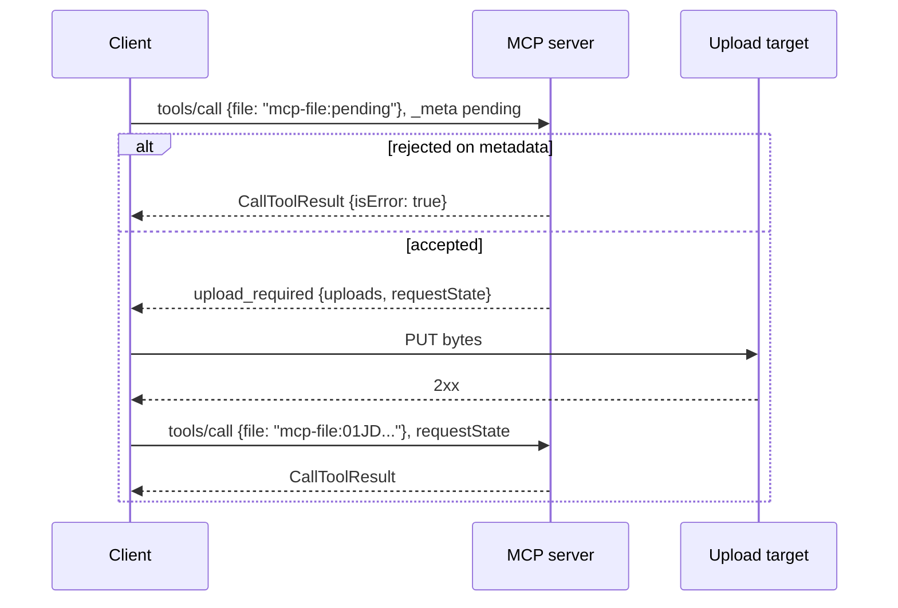

# File Uploads Extension

- **Status**: Experimental draft, not yet proposed as a SEP
- **Extension Identifier**: `io.modelcontextprotocol/files` (provisional)
- **Working Group**: [File Uploads](https://modelcontextprotocol.io/community/working-groups/file-uploads)
- **Editors**: Den Delimarsky (@localden)
- **Discussion**: [File Uploads Working Group Discord thread](https://discord.com/channels/1358869848138059966/1551968557292593172/1552399008440520865)
  and issues in this repository

The working group writes this draft in SEP form so it can submit it as an Extensions Track SEP once a reference implementation exists. Anything here can change before then, including the extension identifier.

## Abstract

This extension lets a client send a file to a tool without passing a large file's bytes through
the model or a JSON-RPC message. A server marks file arguments with the `x-mcp-file` keyword
first proposed in [SEP-2356](https://github.com/modelcontextprotocol/modelcontextprotocol/pull/2356).
To send a file too large to inline, the client calls the tool with a placeholder in the file
argument and the file's metadata in request `_meta`. The server can reject the call on that
metadata. If it accepts, it returns an `upload_required` result with an HTTPS upload target and
a server-issued file URI. The client uploads the bytes and retries the call with the file URI in
place of the placeholder. Small files go inline as RFC 2397 `data:` URIs.

This revision covers uploads. [Future Work](#future-work) lists downloads, chunked and resumable transfer, and file fields in elicitation forms.

## Motivation

MCP has no interoperable way to get a file from a user to a tool. The existing options
(`EmbeddedResource`, `BlobResourceContents`, base64 strings in arguments) put the bytes inside a
JSON-RPC message. When the model emits tool arguments as tokens, the bytes pass through its
context window, and large uploads to remote MCP servers fail.

The File Uploads Working Group collected the cases this blocks at its
[October 2, 2026 meeting](https://github.com/modelcontextprotocol/modelcontextprotocol/discussions/3412):

- A user asks an assistant to save a 40 MB PDF from the conversation into a cloud-storage folder.
- An agent pulls a 200 MB CSV into its code sandbox.
- An agent uploads a 50 MB deck as a new revision of an existing document and keeps the link.
- An enterprise agent uploads or downloads on a user's behalf, with or without the user present,
  to one of many sites or drives, so the call that returns an upload target has to carry the
  destination.

The same meeting recorded the host-side constraints:

- One model turn per upload.
- File contents and credentials never enter the context window.
- Small files stay in band to keep latency down.
- Large files go out of band to avoid base64.
- Uploads work when a gateway holds the OAuth credentials instead of the host.
- File pointers on the wire carry a marker a deterministic proxy can find.

SEP-2356 defined how a server declares a file argument and an inline `data:` encoding, and sent
larger files to URL-mode elicitation instead of defining an upload protocol. It closed without
merging. [SEP-2631](https://github.com/modelcontextprotocol/modelcontextprotocol/pull/2631) added
out-of-band transfer through new `files/authorizeUpload` and `files/authorizeDownload` methods.
Thomas Sarlandie called ordering SEP-2631's biggest flaw. Bytes move before the server sees the
rest of the call, so uploads that permissions, quota, or data residency rules would reject still
consume bandwidth and can land in the wrong region. The group agreed on metadata first, then the
upload target, then bytes, then finalize, and agreed to build on multi-round-trip requests (MRTR)
and existing primitives before adding new ones.

## Specification

In this document, _client_ is the component that speaks MCP to the server: the host, or a
gateway acting for it. _Host_ is the application that presents the model and the user interface.

### Extension identifier

`io.modelcontextprotocol/files`

### Negotiation

A client that can perform out-of-band uploads declares the extension, with no settings, in the
`io.modelcontextprotocol/clientCapabilities` request metadata of every request that may need it:

```json
{ "extensions": { "io.modelcontextprotocol/files": {} } }
```

A server that accepts out-of-band uploads advertises the extension in `server/discover`:

```json
{
  "capabilities": {
    "tools": {},
    "extensions": {
      "io.modelcontextprotocol/files": { "maxInlineBytes": 1048576 }
    }
  }
}
```

`maxInlineBytes` is the largest total decoded size of `data:` values the server accepts in one
request. If the server omits it, clients **SHOULD** use out-of-band transfer for any file larger
than a small, implementation-defined size.

Clients **MUST NOT** send a placeholder or pending-file metadata to a server that did not
advertise the extension. Servers report an oversized `data:` value as a tool error, following
[SEP-1303](https://modelcontextprotocol.io/seps/1303-input-validation-errors-as-tool-execution-errors),
and **MAY** return `MissingRequiredClientCapabilityError` (`-32021`) instead when the request
did not declare the extension.

### File arguments

This section restates the parts of SEP-2356 this extension uses.

A server marks a file argument by adding `x-mcp-file` to a property of the form
`{"type": "string", "format": "uri"}` in `Tool.inputSchema`, including array items:

```typescript
interface FileInputDescriptor {
  /** Media types or dot-prefixed extensions to filter a file picker to. A hint only. */
  accept?: string[];
  /** Largest decoded size of each file, in bytes, on any transfer path. */
  maxSize?: number;
}
```

SEP-2356 applied `maxSize` to inline values only. This extension applies it to every file, as
SEP-2631 proposed.

An `x-mcp-file` value is one of:

- An RFC 2397 `data:` URI. Clients use `application/octet-stream` when the media type is
  unknown.
- A placeholder beginning with `mcp-file:pending`, on the initial call of an out-of-band upload.
  Clients **MAY** append a suffix (`mcp-file:pending:2`) to keep array items distinct.
- A file URI the server issued in an `upload_required` result, on the retry.

Servers **MUST** reject any other value and **MUST NOT** dereference it. Clients **MUST** treat
file URIs as opaque and **MUST NOT** parse, resolve, or pass a file URI to any URI handler.
Servers **SHOULD** mint file URIs under the `mcp-file:` scheme so proxies can recognize them.

Hosts:

- **SHOULD NOT** show `x-mcp-file` properties to a model that emits arguments as tokens.
- **MUST** bind a file to an argument only on the user's selection or under the host's approval
  policy for model-supplied values.
- **MUST NOT** place file bytes, upload URLs, or issued file URIs in model context.

### Upload flow



#### Initial call

The client sends `tools/call` with every argument populated, a placeholder in each out-of-band
file argument or array item, and the pending files' metadata in request `_meta` under the
extension identifier:

```json
{
  "jsonrpc": "2.0",
  "id": 1,
  "method": "tools/call",
  "params": {
    "name": "save_to_folder",
    "arguments": {
      "folderId": "fld_8c1a",
      "file": "mcp-file:pending"
    },
    "_meta": {
      "io.modelcontextprotocol/protocolVersion": "2026-07-28",
      "io.modelcontextprotocol/clientCapabilities": {
        "extensions": { "io.modelcontextprotocol/files": {} }
      },
      "io.modelcontextprotocol/files": {
        "pending": {
          "/file": {
            "name": "Q3 report.pdf",
            "mimeType": "application/pdf",
            "size": 41204133,
            "digest": {
              "algorithm": "sha-256",
              "value": "uU0nuZNNPgilLlLX2n2r-sSE7-N6U4D6ZVe-_rYh2sU"
            }
          }
        }
      }
    }
  }
}
```

Each key in `pending` is a [JSON Pointer](https://www.rfc-editor.org/rfc/rfc6901) to one
placeholder in `arguments` (`/file`, or `/files/2` for an array item). An array argument can mix
inline `data:` items and placeholders.

```typescript
interface FileMetadata {
  name?: string;
  /** "application/octet-stream" if unknown. */
  mimeType: string;
  /** Decoded size in bytes. */
  size: number;
  digest?: { algorithm: "sha-256"; value: string /* base64url, no padding */ };
}
```

Clients **SHOULD** include `digest`. Before sending the initial call, the host **MUST** obtain
the user's approval, or apply operator policy when no user is present, for sending the file to
this server and to storage the server designates.

Servers **SHOULD** run every check that does not need the bytes (destination authorization,
quota, `accept` and `maxSize`, name collisions) and return a `CallToolResult` with
`isError: true` if one fails. Servers **MUST** treat the metadata as client-asserted and re-check
size and type once the bytes arrive.

#### Upload required

If the server accepts the files, it returns a result with `resultType: "upload_required"`, an
extension-defined result type as the
[base protocol](https://modelcontextprotocol.io/specification/draft/basic/index#resulttype)
permits. This extension reserves the value `"upload_required"`.

```json
{
  "jsonrpc": "2.0",
  "id": 1,
  "result": {
    "resultType": "upload_required",
    "uploads": {
      "/file": {
        "uri": "mcp-file:01JD3V7K2M",
        "url": "https://upload.example.com/u/01JD3V7K2M?sig=...",
        "headers": {
          "Content-Type": "application/pdf",
          "x-amz-checksum-sha256": "uU0nuZNNPgilLlLX2n2r+sSE7+N6U4D6ZVe+/rYh2sU="
        },
        "credentials": "omit"
      }
    },
    "requestState": "..."
  }
}
```

```typescript
interface UploadRequiredResult extends Result {
  resultType: "upload_required";
  /** One entry per pending pointer. */
  uploads: { [pointer: string]: UploadTarget };
  requestState: string;
}

interface UploadTarget {
  /** The file URI the client places in the argument on the retry. */
  uri: string;
  /** Absolute https URL. The client sends the bytes with PUT. */
  url: string;
  /** Headers the client sends with the PUT. */
  headers?: { [name: string]: string };
  /**
   * "omit": the URL authorizes itself. "include": the client attaches the credential it
   * presents to the MCP server. See Upload targets.
   */
  credentials: "omit" | "include";
}
```

Servers **MUST** return `upload_required` only on `tools/call` and only to a request that
declared the extension. A server using the
[Tasks extension](https://modelcontextprotocol.io/extensions/tasks/overview) **MUST** return
`upload_required` before creating a task.

Servers **MUST** bind the issued file URIs, the tool name, and the other arguments into
`requestState`, which follows the
[MRTR server rules](https://modelcontextprotocol.io/specification/draft/basic/patterns/mrtr#server-requirements-basic-workflow).
When computing the request digest that MRTR recommends, servers **MUST** exclude the values at
the pointers bound in `requestState`. Clients handle `requestState` as the
[MRTR client rules](https://modelcontextprotocol.io/specification/draft/basic/patterns/mrtr#client-requirements-basic-workflow)
require for `InputRequiredResult`.

Servers **SHOULD** issue targets that write to a staging location and enforce the declared size.
A target that writes to the final destination **MUST** enforce the declared size, and the
digest where the backend supports it. Servers **SHOULD** rely on storage-side expiry to reclaim
uploads with no retry.

#### Transfer

For each `UploadTarget` the client checks the target against [Upload targets](#upload-targets),
sends one PUT to `url` with `headers` and the file bytes as the body, and treats a `2xx`
response as success. Clients **MUST NOT** send more bytes than the declared `size`, and
**SHOULD** bound the number of times they repeat an upload for one call.

The component that holds the bytes performs the transfer. A gateway that holds the credential
but not the bytes can pass `omit` targets to the host, or rewrite an `include` target's `url` to
a relay at its own origin and proxy it.

Clients **MUST** complete the upload and retry without returning control to the model. Servers
**SHOULD NOT** echo upload URLs or issued file URIs in the `CallToolResult`.

Servers that issue `omit` targets to browser clients **SHOULD** configure the storage to answer
the CORS preflight for the listed headers.

#### Retry

The client retries `tools/call` with the same tool name and arguments, each placeholder replaced
by its file URI, and `requestState` echoed:

```json
{
  "jsonrpc": "2.0",
  "id": 2,
  "method": "tools/call",
  "params": {
    "name": "save_to_folder",
    "arguments": { "folderId": "fld_8c1a", "file": "mcp-file:01JD3V7K2M" },
    "requestState": "...",
    "_meta": {
      "io.modelcontextprotocol/protocolVersion": "2026-07-28",
      "io.modelcontextprotocol/clientCapabilities": {
        "extensions": { "io.modelcontextprotocol/files": {} }
      }
    }
  }
}
```

If an upload failed, the client leaves the placeholder in that argument and sends that file's
entry in `pending` again.

On the retry the server:

1. Verifies `requestState` and returns JSON-RPC error `-32602` if verification fails.
2. Rejects the call if the tool name differs from the one bound in `requestState`. If the
   non-file arguments differ, the server either rejects the call or re-runs every metadata check
   on the new arguments.
3. If any placeholder remains, returns a new `upload_required` covering only the pending
   pointers, or a `CallToolResult` with `isError: true`. Servers **MUST NOT** run the tool while
   a placeholder remains.
4. Confirms with the storage backend that each file's bytes arrived (for example with a HEAD
   request or a session status query), verifies `digest` where the backend can do so without
   reading the bytes back, and re-checks size and type. Servers **MUST NOT** run the tool with a
   file whose bytes they have not confirmed.
5. Performs any finalize step the backend needs, runs the tool, and returns its result.

A file URI is valid only in a retry carrying a `requestState` that binds it. A server that
answers a retry with `upload_required` or `input_required` **MUST** bind every file URI it has
not consumed into the new `requestState`. A file URI is consumed when the server starts running
the tool, and servers **MUST** reject a consumed file URI. Failures before that point do not
consume it.

### Upload targets

The server chooses the upload target, and with `credentials: "include"` the client attaches a
user credential to a request the server directed. These rules apply to every target:

1. Clients **MUST** reject a `url` that is not an absolute `https` URL.
2. Clients **MUST NOT** connect to an address that the
   [IANA special-purpose registries](https://www.rfc-editor.org/rfc/rfc6890) mark as not
   globally reachable, checked on the address they connect to, unless an operator allowlist
   permits it. Clients **MUST NOT** follow redirects.
3. Clients **MUST** reject a target whose `headers` include `Authorization`, `Cookie`, a
   [forbidden request header](https://fetch.spec.whatwg.org/#forbidden-request-header), or a
   name or value that is not valid under [RFC 9110](https://www.rfc-editor.org/rfc/rfc9110#section-5).
4. Clients **MUST** honor `credentials: "include"` only when `url` has the same origin as the MCP
   server's
   [canonical URI](https://modelcontextprotocol.io/specification/draft/basic/authorization/index#canonical-server-uri)
   and a path equal to the canonical path or starting with it followed by `/`. In a gateway
   deployment this is the canonical URI of the server whose credential is attached. Otherwise
   the client **MUST** treat the target as `"omit"` or refuse it.

On stdio there is no canonical URI, so only `omit` targets apply.

## Rationale

### Why an extension result type

SEP-2631 negotiated uploads in a separate `files/authorizeUpload` call before `tools/call`. The
server had to issue a regional upload URL before it saw the arguments, so it could not check the
destination or quota first, and the two calls had no protocol-level link. Returning the upload target from `tools/call` lets the server see the full call first, and `requestState`
carries the binding so any instance can serve the retry.

An earlier version of this draft carried the target as a new `files/upload` entry in an
`InputRequiredResult`. The MRTR rules and the schema allow only elicitation, sampling, and roots
requests there, so that design needed a change to the specification. The base protocol lets
extensions add result types, and the Tasks extension does so. A server then cannot ask for an upload and an elicitation in the same round trip.

### Why a placeholder and `_meta`

SDKs and gateways can validate `arguments` against `inputSchema` before a handler runs, so the
initial call cannot omit a required file argument. A placeholder passes that validation and
marks the argument. The metadata goes in request `_meta` under the extension's key because the
argument's schema is a URI string and cannot hold an object.

### Why `omit` and `include`

The working group heard that sending the user's credential has to be optional, so a token never
reaches third-party storage, and that some enterprise deployments reject pre-signed URLs and
want the data plane authorized with the same token as the control plane. A per-target flag
covers both. Tying `include` to the server's canonical URI keeps the token within the resource
it was issued for. The group has not finished listing the authorization methods it needs to
support, and this pair is a starting point.

### Prior art

- SEP-2356, for the declaration keyword, inline encoding, and host rules.
- SEP-2631, for file URIs, digests, transfer descriptors, and the `maxSize` change.
- [SEP-2532](https://github.com/modelcontextprotocol/modelcontextprotocol/pull/2532) (resource
  streaming), which Patrick Rodgers offered as a way to get file bytes from a server.
- Storage APIs that separate creating an upload from sending the bytes (pre-signed URLs and
  upload sessions).

## Backward Compatibility

The extension is additive and off by default. A client that does not declare it never receives
`upload_required`. A server that does not advertise it receives `data:` URIs up to its declared
`maxSize`. Tools that take base64 or URL strings today keep working.

SDKs that validate `tools/call` results against `CallToolResult | InputRequiredResult` need a
hook for extension result types before they can carry `upload_required`.

## Security Implications

[Upload targets](#upload-targets) covers requests the server directs the client to make.
A client that relaxes those rules lets a server use it for server-side request forgery and can leak the user's credential to other resources.

Binding the tool name, arguments, and file URIs in `requestState`, and consuming each file URI
once, prevents a client from uploading under one call's authorization and attaching the file to
another call or a different destination. A target that enforces the declared size and digest
prevents anyone who sees an `omit` URL from replacing the bytes before the retry.

Servers **SHOULD** follow
[OWASP ASVS 5.0 V5](https://github.com/OWASP/ASVS/blob/v5.0.0/5.0/en/0x14-V5-File-Handling.md)
for the formats they accept.

Clients and servers **MUST** redact upload URLs, upload headers, and `data:` values in logs,
traces, and error reports.

## Reference Implementation

The reference implementation will include a TypeScript SDK branch with the `upload_required`
result type and a client transfer helper, a reference server in front of an object store, and
conformance scenarios for inline transfer, out-of-band transfer, rejection on metadata, a failed
upload, and a digest mismatch.

## Open Questions

1. **`upload_required` or an input request.** An input request inside `InputRequiredResult`
   would let a server combine an upload with an elicitation in one round trip, at the cost of a
   change to the specification. Is that worth it?
2. **Mandatory digest.** Requiring `digest` closes the byte-replacement gap for `omit` targets,
   but Web Crypto cannot hash a large file in chunks, so browsers have to read the whole file first.
3. **Authorization methods.** The working group agreed to list every method it has to support,
   including storage that needs a credential separate from the MCP one and HTTP Message
   Signatures.
4. **Finalize.** As written the server finalizes while handling the retry. Owners of backends
   with an explicit commit step should confirm that works for them.
5. **How the tool's typed result reaches the model**, raised at the October 2 meeting.
6. **stdio.** Out-of-band `omit` targets work for stdio servers. Should anything more be defined
   for them?
7. **Resources.** Do resources fit this flow? Thomas Sarlandie took this as an action item on
   October 2.
8. **The `mcp-file:` scheme.** Require it for issued file URIs, or leave the scheme to the
   server under the opacity rules.
9. **Multipart and POST.** Some storage APIs take only `multipart/form-data`. They can sit
   behind a server proxy with `include`, or a later revision can add a `form` target.

## Future Work

- **Downloads.** A download target that mirrors `UploadTarget`, with the same rules.
- **Chunked and resumable transfer**, for backends with per-request size limits and for
  interrupted transfers, once a standard settles.
- **Elicitation forms.** Out-of-band upload for `x-mcp-file` fields in `elicitation/create`.
- **Promotion to the specification**, after the working group has validated the extension in
  use, per its October 2 decision.

## Acknowledgments

This draft builds on SEP-2356 by Olivier Chafik and SEP-2631 by Casey Chow, and on the File
Uploads Working Group's October 2, 2026 meeting with Wil St. Charles, Kurtis Van Gent, Thomas
Sarlandie, and Kryspin Ziemski. Thomas Sarlandie proposed modeling the upload as a
multi-round-trip request.
