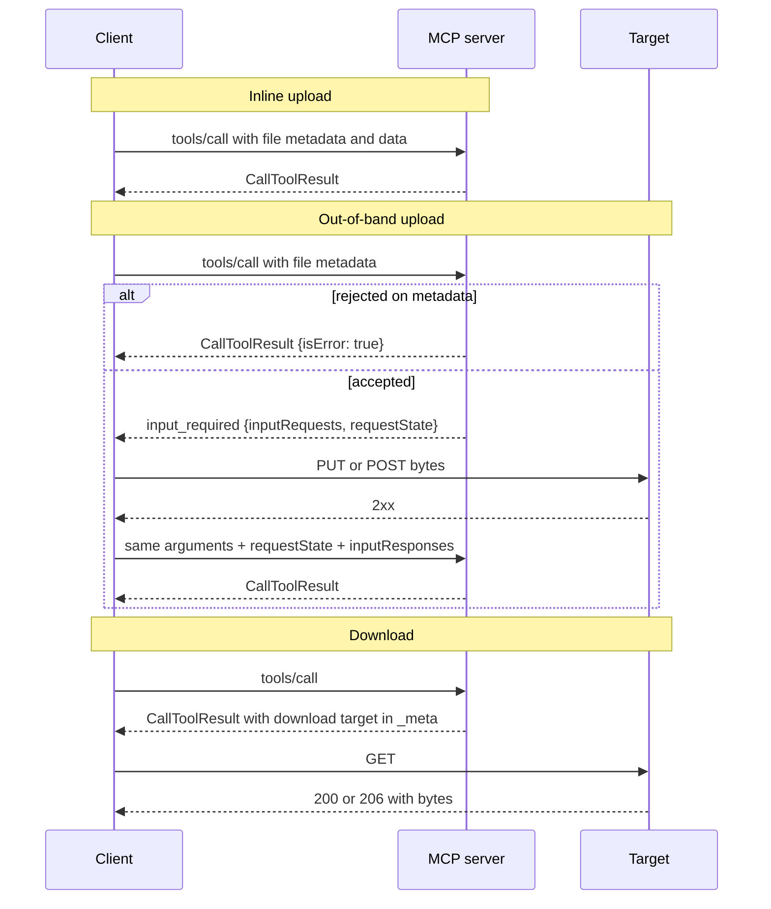

# File Uploads and Downloads Extension

- **Status**: Draft
- **Extension Identifier**: `io.modelcontextprotocol/files` (provisional)
- **Working Group**: [File Uploads](https://modelcontextprotocol.io/community/working-groups/file-uploads)
- **Contributors**: Den Delimarsky (@localden), Wil St. Charles (@st-charles), Thomas Sarlandie
  (@tsarlandie-oai), Patrick Rodgers (@patrick-rodgers), Kurtis Van Gent (@kurtisvg), Kryspin Ziemski
  (@kziemski), Mike Eastes (@meastes)
- **Discussion**: [File Uploads Working Group Discord thread](https://discord.com/channels/1358869848138059966/1551968557292593172/1552399008440520865)
  and issues in this repository

The working group plans to submit this document as an Extensions Track SEP once a reference
implementation exists. Anything here can change before then, including the extension identifier.

## Abstract

This extension defines how MCP clients transfer files to and from tools. Files transferred out of
band do not enter model context or JSON-RPC messages.

A client has two options for uploading a file:

- **Inline**: The client sends a small file in the tool call.
- **Out of band**: The client calls the tool with the file's metadata. The server either returns an
  upload target or rejects the call based on the metadata. If the server returns a target, the
  client uploads the bytes and retries the call.

To download a file, the client fetches it from a download target that the tool lists in its result.

## Specification

This revision applies to tools. Resource behavior is unchanged from the base protocol.

### Terms

- **Client**: The component that sends MCP requests to the next hop. A host behind a gateway is a
  client of the gateway, and the gateway is a client of the server.
- **Host**: The application that presents the model and the user interface.
- **MCP address**: The URL a client sends MCP requests to. This URL can vary per hop and can differ
  from the server's canonical URI.
- **Target**: The URL or path to which a client sends file bytes, or from which it fetches them.
- **Gateway**: An intermediary that is a server to its caller and a client of the next hop.
- **Relay**: A gateway that replaces a target with its own and carries the bytes between its caller
  and the original target.
- **Logical call**: An initial `tools/call` request and its retries, on one hop. A gateway's call to
  a server is a separate logical call from its caller's call to the gateway.

In [Transfer](#transfer), [Downloads](#downloads), and [Targets](#targets), client means the
component that performs the transfer.

### Capabilities

The extension identifier is `io.modelcontextprotocol/files`.

Clients **MUST** declare the extension in the `io.modelcontextprotocol/clientCapabilities` metadata
of every request that may need it:

```json
{ "extensions": { "io.modelcontextprotocol/files": { "upload": {}, "download": {} } } }
```

Servers advertise the extension in the `server/discover` response:

```json
{
  "capabilities": {
    "tools": {},
    "extensions": {
      "io.modelcontextprotocol/files": {
        "upload": {},
        "maxInlineBytes": 1048576
      }
    }
  }
}
```

The settings object has the following fields:

- `upload` _(optional)_: The sender supports out-of-band uploads.
- `download` _(optional, clients only)_: The client accepts download targets.
- `maxInlineBytes` _(optional, servers only)_: The largest total decoded size of inline `data`
  values the server accepts in one request. If `0` or absent, the server does not accept inline
  transfer.

Receivers **MUST** ignore fields they do not recognize in these settings.

Clients:

- **MUST NOT** use this extension with a server that did not advertise it.
- **MUST NOT** send inline `data` above `maxInlineBytes` in total, treating an absent value as `0`.
- **MUST NOT** send a file out of band to a server that did not advertise `upload`.

### Flow

A client sends a file inline or out of band. A tool returns a file through a download target.



### File Arguments

A server marks a file argument by adding `x-mcp-file` directly to the argument's object schema in
`Tool.inputSchema`. This behavior is consistent with
[`x-mcp-header`](https://modelcontextprotocol.io/specification/draft/server/tools#x-mcp-header).
`x-mcp-file` applies to objects and can appear in array items. Servers **MUST** make the marked
schema require the `FileInput` shape.

```typescript
/** The value of x-mcp-file. */
interface FileInputDescriptor {
  /** Media types or dot-prefixed extensions for a file picker. Servers can reject a file by type. */
  accept?: string[];
  /** Maximum decoded size of each file in bytes, for inline and out-of-band transfer. */
  maxSize?: number;
}

interface FileInput {
  id: string;
  name?: string;
  /** "application/octet-stream" if unknown. */
  mimeType: string;
  /** Non-negative integer; decoded size in bytes. */
  size: number;
  /** SHA-256 over the original bytes. A tool that needs it requires it in its schema. */
  digest?: { algorithm: "sha-256"; value: string /* base64url, no padding */ };
  /**
   * RFC 4648 base64-encoded file bytes. If absent and size is greater than 0, the client requests
   * an out-of-band upload.
   */
  data?: string;
}
```

This can be represented in a server's schema as follows:

```json
{
  "name": "save_to_folder",
  "inputSchema": {
    "type": "object",
    "properties": {
      "folderId": { "type": "string" },
      "file": {
        "type": "object",
        "x-mcp-file": { "accept": ["application/pdf"], "maxSize": 157286400 },
        "properties": {
          "id": { "type": "string" },
          "name": { "type": "string" },
          "mimeType": { "type": "string" },
          "size": { "type": "integer", "minimum": 0 },
          "digest": {
            "type": "object",
            "properties": {
              "algorithm": { "const": "sha-256" },
              "value": { "type": "string" }
            },
            "required": ["algorithm", "value"]
          },
          "data": { "type": "string" }
        },
        "required": ["id", "mimeType", "size"]
      }
    },
    "required": ["folderId", "file"]
  }
}
```

Clients **MUST** make each `id` unique within the call. Servers **MUST** validate the decoded size
before using the bytes. If the tool's schema requires `digest`, servers **MUST** check it against
inline `data` and empty files.

A file with `size` 0 has no bytes to transfer. Clients **MUST** omit `data` for it. Servers **MUST**
treat it as an empty file and **MUST NOT** issue a target for it. Servers **SHOULD** treat an empty
`data` string the same way. A tool can still reject an empty file.

Clients that do not support this extension ignore the keyword.

Hosts:

- **SHOULD NOT** show `x-mcp-file` properties to a model that emits arguments as tokens.
- **MAY** instead show the model a substitute parameter whose value is a host-defined handle, and
  replace the handle with a `FileInput` before sending the call.
- **MUST** bind a file to an argument only on the user's selection or under the host's approval
  policy for model-supplied values.
- **MUST NOT** place file bytes or any target in model context.

These rules apply to any file the host can read, including a file an agent created. This extension
does not define how a host presents a result to the model.

### Uploads

The upload flow keeps no protocol session state by default. Each retry carries its context in the
request and in `requestState`, so any instance that can reach the storage can process it.

#### Initial Call

The client sends `tools/call` with every argument populated, and omits `data` for each file it will
upload out of band. The request examples omit `_meta`.

```json
{
  "jsonrpc": "2.0",
  "id": 1,
  "method": "tools/call",
  "params": {
    "name": "save_to_folder",
    "arguments": {
      "folderId": "fld_8c1a",
      "file": {
        "id": "file-1",
        "name": "Q3 report.pdf",
        "mimeType": "application/pdf",
        "size": 41204133
      }
    }
  }
}
```

Before this call, the host **MUST** obtain the user's approval to send the file to this server and
to storage the server designates, or apply operator policy when no user is present.

Servers **SHOULD** perform every check that does not require the bytes, such as destination
authorization, quota, `accept`, and `maxSize`, and return a `CallToolResult` with `isError: true` if
one fails. Servers **MUST** treat the metadata as client-asserted, re-check size and type once the
bytes arrive, and **MUST NOT** rely on a `digest` they did not verify.

The tool decides whether an existing file with the same name is a conflict. A tool that supports
conditional writes accepts the revision or condition as a tool argument.

#### Upload Request

If the server accepts the files, it returns an `InputRequiredResult` with an upload input request
under `inputRequests.uploads`. This method needs a core MRTR extension point, because the
input-request and input-response unions are closed. The fixed `uploads` key also differs from core
MRTR, where keys are server-assigned.

```json
{
  "jsonrpc": "2.0",
  "id": 1,
  "result": {
    "resultType": "input_required",
    "inputRequests": {
      "uploads": {
        "method": "io.modelcontextprotocol/files/upload",
        "params": {
          "files": [
            {
              "fileId": "file-1",
              "url": "https://upload.example.com/u/01JD3V7K2M?sig=...",
              "headers": { "Content-Type": "application/pdf" },
              "credentials": "omit",
              "expiresAt": "2026-11-04T18:30:00Z"
            }
          ]
        }
      }
    },
    "requestState": "..."
  }
}
```

```typescript
interface UploadInputRequest {
  method: "io.modelcontextprotocol/files/upload";
  params: { files: UploadTarget[] };
}

interface UploadTarget {
  /** The corresponding FileInput.id in the original arguments. */
  fileId: string;
  /** Absolute https URL. Exactly one of url and path is present. */
  url?: string;
  /** Path under the MCP address. Exactly one of url and path is present. */
  path?: string;
  /** Defaults to "PUT". */
  method?: "PUT" | "POST";
  /** Sends the file as multipart/form-data. Requires method "POST". */
  form?: UploadForm;
  /** Headers the client sends with the transfer. */
  headers?: { [name: string]: string };
  /**
   * "omit": the target carries its own authorization. "include": the client attaches its MCP
   * credential.
   */
  credentials: "omit" | "include";
  /** ISO 8601 timestamp. Advisory latest start time for the transfer. */
  expiresAt?: string;
  /** Carries no transfer semantics. */
  _meta?: { [key: string]: unknown };
}

interface UploadForm {
  /** Fields the client sends before the file, in array order. */
  fields: { name: string; value: string }[];
  /** Name of the form field that carries the file. */
  fileField: string;
}
```

A storage API that accepts only `multipart/form-data` uses a `form` target:

```json
{
  "fileId": "file-1",
  "url": "https://upload.example.com/",
  "method": "POST",
  "form": {
    "fields": [
      { "name": "key", "value": "staging/01JD3V7K2M" },
      { "name": "policy", "value": "..." },
      { "name": "signature", "value": "..." }
    ],
    "fileField": "file"
  },
  "credentials": "omit",
  "expiresAt": "2026-11-04T18:30:00Z"
}
```

Servers:

- **MUST** return an upload input request only on `tools/call`, and only to a request that declared
  `upload`.
- **MUST** make each `fileId` match one non-empty file argument without `data`.
- **MUST** list every non-empty file argument without `data` in the upload input request, each
  `fileId` once.
- **MUST** record in `requestState` that an upload input request was issued, and carry that record
  into every later `requestState` of the logical call.
- **MUST NOT** return an upload input request on a retry whose `requestState` holds that record.
- **MUST NOT** use a target for a different call.
- **MUST** return the upload input request before creating a task, if they use the [Tasks
  extension](https://modelcontextprotocol.io/extensions/tasks/overview).
- **MUST** bind the tool name, all arguments, each file's target, and the authenticated principal,
  if any, to `requestState`.
- **MUST NOT** allow a target to remain valid after the `requestState` it was issued under expires.

A server issuing targets for large files **SHOULD** choose a `requestState` lifetime that covers a
transfer started at `expiresAt`, plus the retry.

#### Transfer

The client checks the target against [Targets](#targets), then sends the file to the target's `url`
or resolved `path`, with `method` and `headers`. Without `form`, the file bytes are the request
body. With `form`, the body is `multipart/form-data` as defined in [RFC
7578](https://www.rfc-editor.org/rfc/rfc7578). A `2xx` response indicates success.

Clients:

- **MUST** support `form` targets if they declare `upload`.
- **MUST** send each entry in a `form` target's `fields` as one part, in array order, then send the
  file as the last part, named `fileField`.
- **MUST** quote each part's `name`, and quote the file's `filename` in UTF-8, writing its `"`, CR,
  and LF as `%22`, `%0D`, and `%0A`, as the [WHATWG multipart/form-data
  encoding](https://html.spec.whatwg.org/multipage/form-control-infrastructure.html#multipart/form-data-encoding-algorithm)
  does, and **MUST NOT** send `filename*`.
- **MUST** set `filename` to the base name of `FileInput.name`, taken after both `/` and `\`. If
  `name` is absent, or the base name is empty, `.`, or `..`, the `filename` is `file`.
- **MUST** set the file part's `Content-Type` to `FileInput.mimeType` if it is a valid media type,
  and otherwise to `application/octet-stream`.
- **MUST** use a boundary with at least 128 bits of randomness.
- **MUST** send `Content-Length`.
- **MUST NOT** send more file bytes than the declared `size`.
- **SHOULD NOT** start a transfer after `expiresAt`.
- **MAY** repeat a failed `PUT` to the same target, up to a bound per file, and **MUST NOT**
  automatically resend a `POST` unless they know the target did not apply it.
- **MUST** treat the call as failed if they receive a second upload input request in the logical
  call, and **MUST NOT** transfer to its targets or retry the call.

- **MUST** finish the upload flow without returning control to the model.

Clients **MUST** send the retry only if every requested file received a `2xx` response. If a target
is rejected, a transfer fails, or the user cancels, the client **MUST NOT** send the retry, and
**SHOULD** stop any other transfer in the logical call. The tool has not run. A gateway that
performs the transfer itself **MUST** return `isError: true` to its caller. A host **MUST** tell the
user or model that the tool did not run, and **MUST NOT** claim that no bytes were stored.


#### Retry

When retrying, the client sends the same tool name and arguments, and an empty object under
`inputResponses.uploads`:

```json
{
  "jsonrpc": "2.0",
  "id": 2,
  "method": "tools/call",
  "params": {
    "name": "save_to_folder",
    "arguments": {
      "folderId": "fld_8c1a",
      "file": {
        "id": "file-1",
        "name": "Q3 report.pdf",
        "mimeType": "application/pdf",
        "size": 41204133
      }
    },
    "inputResponses": { "uploads": {} },
    "requestState": "..."
  }
}
```

```typescript
/** Empty. Its presence states that every requested file received a `2xx` response. */
interface UploadInputResponse {}
```

The retry does not show that the bytes arrived.

On a retry that answers an upload input request, the server **MUST** perform these steps in order,
and **MUST** respond as [Errors](#errors) specifies when a step fails:

1. Verify `requestState`. A consumed `requestState` fails verification.
2. Check the tool name and arguments against the values bound in `requestState`. Compare arguments
   with [JSON Schema instance
   equality](https://json-schema.org/draft/2020-12/json-schema-core#section-4.2.2), so member order
   and number spelling do not matter. A server that binds a hash **MUST** hash a form that preserves
   this.
3. Check that `inputResponses.uploads` is present.
4. Confirm with the storage that the bytes of each file bound in `requestState` arrived, for example
   with a `HEAD` request or a session status query. If the tool's schema requires `digest`, verify
   it by hashing the bytes, by comparing a SHA-256 the storage computed from them, or by a write the
   storage rejects on mismatch, where the target's authorization fixes the expected digest. A weaker
   hash or a client-supplied value does not verify it. Re-check size and type. The server
   **MUST NOT** run the tool with bytes it has not confirmed.
5. If running the tool twice is unsafe, consume `requestState` as specified in [Repeated
   Retries](#repeated-retries). If another retry consumed it first, respond as for step 1.
6. Perform any finalize step the storage needs, run the tool, and return its result.

If a file's bytes have not arrived at step 4, the server **MAY** wait for them. If they do not
arrive, it **MUST NOT** run the tool.

This extension narrows two [MRTR
rules](https://modelcontextprotocol.io/specification/draft/basic/patterns/mrtr) for upload input
requests only. A server does not prompt again, and does not re-request a missing `uploads` response.
Other input requests are unaffected.

A server that returns a later `InputRequiredResult` in the logical call **MUST** bind each file's
confirmation to its `requestState`. On the retry that answers it, the server performs the steps
above that it has not completed.

#### Repeated Retries

If a client sends the retry that answers an upload input request, or a later retry in the logical
call, and does not receive the response, the outcome is unknown. The tool may have run, in whole or
in part. Clients and gateways **MUST NOT** resend the retry or restart the call automatically unless
they know the server did not process it. A `-32602` response does not show that the tool did not
run.

A gateway that does not receive the response **MUST** return `isError: true` to its caller, stating
that the outcome is unknown. A host **MUST** tell the user or model so. Any new call needs the
approval described in [Initial Call](#initial-call).

A tool that is safe to run twice, such as one that is idempotent on its arguments, needs nothing
more. If a retry repeats, the server runs the tool again and treats a file it already finalized as
confirmed at step 4.

For a tool that is unsafe to run twice, the server **MUST** accept each `requestState` at most once,
from the one that answers the upload input request onward.
[MRTR](https://modelcontextprotocol.io/specification/draft/basic/patterns/mrtr#server-requirements-basic-workflow)
leaves this to the server. The server **MUST** consume each one atomically, in storage every
instance shares, before it runs the tool or returns a later `InputRequiredResult`. It **MUST** issue
a distinct `requestState` in each result, give each an expiry, and keep the record until that
expiry.

A tool that can outlast a client or gateway timeout **SHOULD** use the [Tasks
extension](https://modelcontextprotocol.io/extensions/tasks/overview).

#### Staging

Staged bytes are application data that `requestState` refers to. They are not protocol session
state.

Servers **SHOULD** issue targets that write to a staging location, enforce the declared size, and
accept one write, and **SHOULD** finalize a copy of the bytes they confirmed. Servers **MUST** keep
staged bytes until the latest `requestState` bound to them expires, and **MUST NOT** expose a staged
file as finished until they confirm it on the retry. If the tool's schema requires `digest` and the
target stays writable, servers **MUST** verify it on a copy the target cannot write, and run the
tool on that copy.

Servers **MUST NOT** issue a target that writes to the final destination unless the storage enforces
the declared size on the write, the write cannot replace existing content, and the server can remove
an unconfirmed file. The server **MUST** remove the file if a later check fails or no retry arrives
before the `requestState` expires.

### Downloads

> **Note**: The working group has discussed downloads but has not reviewed this shape. See [Open
> Questions](#open-questions).

A tool returns files by listing them in the `_meta` of its `CallToolResult`, under the extension
identifier, with one entry per file. The server **MUST** also describe the result in `content`:

```json
{
  "jsonrpc": "2.0",
  "id": 3,
  "result": {
    "resultType": "complete",
    "content": [{ "type": "text", "text": "Exported q3-orders.csv." }],
    "_meta": {
      "io.modelcontextprotocol/files": {
        "downloads": [
          {
            "name": "q3-orders.csv",
            "mimeType": "text/csv",
            "size": 209715200,
            "url": "https://download.example.com/d/01JD3V9P4Q?sig=...",
            "credentials": "omit",
            "expiresAt": "2026-11-04T18:30:00Z"
          }
        ]
      }
    }
  }
}
```

```typescript
interface ResultFilesMeta {
  downloads: DownloadTarget[];
}

interface DownloadTarget {
  name?: string;
  /** "application/octet-stream" if unknown. */
  mimeType: string;
  /** Non-negative integer; size in bytes, after any Content-Encoding is removed. */
  size: number;
  /** SHA-256 over the whole file, after any Content-Encoding is removed. */
  digest?: { algorithm: "sha-256"; value: string /* base64url, no padding */ };
  /** url, path, credentials, and expiresAt have the same meaning as in UploadTarget. */
  url?: string;
  path?: string;
  /** Headers the client sends with the `GET`. */
  headers?: { [name: string]: string };
  credentials: "omit" | "include";
  expiresAt?: string;
  /** Carries no transfer semantics. */
  _meta?: { [key: string]: unknown };
}
```

Servers:

- **MUST** add a download target only to the result of a call whose `tools/call` request declared
  `download`, however that result is delivered.
- **MUST NOT** list a target until the file can be fetched. This extension does not define how a
  tool waits for a file to exist.

The client sends a `GET` to the target's `url` or resolved `path` with `headers`. A `200` response,
or a `206` response to a range request, indicates success. Clients **MAY** use range requests as
[RFC 9110](https://www.rfc-editor.org/rfc/rfc9110#section-14) defines them to split or resume a
download. Ranges apply to the bytes as sent, while `size` describes the file after any
`Content-Encoding` is removed.

Clients:

- **MUST** check `size`, and `digest` if present, after receiving the whole file, and **MUST**
  discard a file that fails a check.
- **MUST** treat `name`, `mimeType`, `size`, and the bytes as untrusted.
- **MUST NOT** use `name` as a filesystem path without reducing it to a safe base name.
- **MUST** abort once the decoded bytes exceed `size`.
- **SHOULD NOT** start a download after `expiresAt`.
- **SHOULD** fetch a file they want before returning control to the model, if user or operator
  policy permits. A target cannot be renewed.
- **MUST NOT** repeat the call automatically. A repeated call runs the tool again.

Servers can return small files as embedded resources, as defined in the base protocol.

### Targets

These rules apply to every upload and download target. A member whose value is `null` is absent, and
clients **MUST** ignore `_meta`. Header names are compared case-insensitively.

Clients **MUST** reject a target that:

1. Does not conform to its type: it lacks exactly one of `url` and `path`, lacks a required member,
   has a value its type does not allow, or has, at any depth, a member other than `_meta` that
   neither this extension nor a declared capability defines.
2. Has a `url` that is not an absolute `https` URL or that contains userinfo, or a `path` that does
   not match `1*( "/" segment )`, where `segment` is one or more ASCII letters, digits, `-`, `_`,
   `~`, or `.`, and is neither `.` nor `..`.
3. Has `headers` that include `Authorization`, `Cookie`, a [forbidden request
   header](https://fetch.spec.whatwg.org/#forbidden-request-header), or a name or value not valid
   under [RFC 9110](https://www.rfc-editor.org/rfc/rfc9110#section-5).
4. Is a `path` target or has `credentials: "include"`, and has `headers` that include `Forwarded`,
   `X-Original-URL`, `X-Rewrite-URL`, `X-HTTP-Method-Override`, `X-HTTP-Method`,
   `X-Method-Override`, or a name starting with `X-Forwarded-`.
5. Has `form`, and its `method` is not `POST`; its `headers` include `Content-Type`,
   `Content-Encoding`, `Content-Range`, `Content-Digest`, or `Repr-Digest`; its `fileField` or a
   field `name` is empty or contains a control character, `"`, or `\`; a field `name` equals
   `fileField`; or a field `value` contains a CR, LF, or NUL character.

Clients **MUST** treat a `401` or `403` from a target as a failed transfer, and **MUST NOT** start
authorization discovery from it. Servers **MUST NOT** include a target in a result's `content`.

#### Credentials

With `include`, clients **MUST** attach the `Authorization` credential they send on MCP requests to
that MCP address, and no other. With `omit`, clients **MUST NOT** attach that credential, cookies,
client certificates, or platform-supplied authentication.

Clients **MUST** honor `include` only on a `path` target, or when `url` has the same [RFC
6454](https://www.rfc-editor.org/rfc/rfc6454) origin as the server's [canonical
URI](https://modelcontextprotocol.io/specification/draft/basic/authorization#canonical-server-uri).
Behind a gateway, the comparison uses the canonical URI of the server whose credential is attached.
Otherwise the client **MUST** reject the target.

`include` lets a server choose the path, method, and body of a request sent with the client's
credential. Servers **MUST NOT** issue an `include` target for a URL that another application
serves, including one behind the same reverse proxy. Servers **MUST** verify that the credential on
an `include` target identifies the principal the target was issued to.

#### Addresses

Clients **MUST** check the address they connect to, and **MUST NOT** connect to one the [IANA
special-purpose registries](https://www.rfc-editor.org/rfc/rfc6890) mark as not globally reachable,
unless an operator allowlist permits it or the target is a `path` under an `https` or loopback MCP
address. A client behind a forward proxy **MUST** use a proxy that refuses these addresses after
resolving the name, or **MUST** reject `url` targets not on an operator allowlist. A browser page
that sends the transfer with `fetch` meets this rule through the browser's own limits, because it
has no more reach than any web page. No other client qualifies through CORS alone.

#### Redirects

Clients **MUST NOT** follow redirects, and **MUST** treat a `3xx` response as a failed transfer.
Servers **MUST NOT** ask the storage to answer a `form` upload with a redirect.

#### Resolving `path`

A client resolves a `path` by appending it to the path of the MCP address, without a doubled `/` and
before any query string. With the MCP address `https://gateway.example.com/mcp/abc`, `/uploads`
resolves to `https://gateway.example.com/mcp/abc/uploads`. The query string of the MCP address is
kept. A `path` target inherits the scheme of the MCP address. If the client followed a redirect to
reach the MCP address, it resolves against the redirect's result. Clients **MUST** reject a `path`
target over `http` unless the MCP address is on loopback or an operator allowlist permits it.

#### stdio

Servers on stdio **MUST** issue only `url` targets with `credentials: "omit"`. The stdio transport
has no canonical URI or MCP address.

### Gateways

The component that holds the bytes to upload, or that will keep a downloaded file, performs the
transfer unless a gateway relays it.

A gateway **MAY** relay a target by replacing its `url` or `path`, `form`, `headers`, and
`credentials` with a target at its own origin, keeping `method`. It **MUST** relay a `url` target
with `credentials: "include"` when it holds that server's credential. A relay is a client of the
original target, so every client rule applies upstream. To its caller, it is a target. A relay:

- **MUST** forward only the `upload` and `download` settings it implements.
- **MUST** present a `form` target without `form`, and build the multipart body from the `FileInput`
  that `fileId` names.
- **MUST NOT** answer `2xx` until the original target has, and **MUST** abort a streamed response
  without completing it if the transfer or a check fails.
- **MUST** pass `size` and `digest` through unchanged unless it changes a download's bytes, and then
  **MUST** update `size` and update or remove `digest`.

A gateway **MUST NOT** forward its caller's credential upstream, and **MUST** return `isError: true`
rather than pass a second upload input request to its caller. A gateway presenting more than one
server at one MCP address **MUST** replace every `path` target. Any other gateway that passes one
through unchanged **MUST** route everything under that MCP address to that one server, and **MUST**
attach its own credential when the target has `credentials: "include"`. Operators **SHOULD NOT**
enable this extension behind a gateway that does not implement it.

### Errors

Servers **MUST** respond as shown. Conditions about a retry apply to a retry that answers an upload
input request. `-32021` is
[`MissingRequiredClientCapabilityError`](https://modelcontextprotocol.io/specification/draft/schema#missingrequiredclientcapabilityerror).

| Condition                                                                                                                                               | Response                                                                 |
| ------------------------------------------------------------------------------------------------------------------------------------------------------- | ------------------------------------------------------------------------ |
| Non-empty file omits `data`, server has `upload`, request did not declare it                                                                            | `-32021` with `data.requiredCapabilities` listing the missing capability |
| Server knows the tool can only return a download, request did not declare `download`                                                                    | `-32021` as above, before running the tool                               |
| Inline `data` is over `maxInlineBytes` in total, not accepted, undecodable, or fails a size or digest check; duplicate `id`; or no way to accept a file | `isError: true`, without running the tool                                |
| `requestState` fails verification or was consumed; tool name or arguments differ from it; `inputResponses.uploads` is missing or not an object          | JSON-RPC `-32602`                                                        |
| Bytes have not arrived or fail a check                                                                                                                  | `isError: true`, without running the tool                                |

## Backward Compatibility

This extension is optional. Tools that accept file content inline today, such as base64 strings,
continue to work. A tool that adopts `x-mcp-file` changes its `inputSchema`, so a client without
this extension sees an object argument it cannot populate correctly.

## Security Implications

Clients and servers **MUST** redact target URLs, target headers, `form` fields, and inline `data` in
logs, traces, and error reports.

### Server-Directed Requests


Enforcing [Targets](#targets) does not stop a malicious server from sending a request of its choice
to a public address, from the client's network position. With `form`, the server controls most of
the request body. Targets do not protect services that trust a client's address, or form handlers
without their own request-forgery defense. Whether a client sends the retry also tells the server
whether every target accepted the request. Host approval happens before the target is known, so it
does not cover this risk. Hosts **SHOULD** restrict `omit` targets to an allowlist of origins where
an operator can provide one, and **SHOULD** do so for `form` targets in unattended use.

### Exfiltration

A malicious server can name any public URL as an `omit` target and receive the file there. `POST`
reaches more existing endpoints than `PUT`, and `form` also reaches HTML form handlers. The host
approval required before the initial call mitigates this risk.

### Writable Targets

A target that stays writable lets anyone holding it replace the file with same-size bytes, and
pre-signed URLs often cannot be revoked. Servers rely on short lifetimes, targets that accept one
write, or a copy of the confirmed bytes. A tool can also require `digest`.

### Secret URLs

A URL that carries its own authorization is a secret for as long as it is valid. Servers **SHOULD**
issue such URLs with the shortest lifetime that covers the expected transfer.

### Downloaded Files

A download target needs no user approval, so a result can make a client send a `GET` of the server's
choosing, with the server's headers, and the request tells the server the client acted on the
result. A downloaded file can contain instructions aimed at the model, or content that harms an
application that opens it. Hosts **SHOULD** apply a storage limit per result as well as per file.

### File Contents

Servers **SHOULD** follow [OWASP ASVS 5.0
V5](https://github.com/OWASP/ASVS/blob/v5.0.0/5.0/en/0x14-V5-File-Handling.md) for the formats they
accept.

## Reference Implementation

The reference implementation will include a TypeScript SDK branch with the upload input request and
a client transfer helper, a reference server in front of an object store, and conformance scenarios
for inline transfer, out-of-band transfer, a `form` target, target rejection, rejection on metadata,
a failed transfer with no retry, a size mismatch, a consumed `requestState`, a second upload input
request, and a download.

## Open Questions

1. **MRTR extensibility.** How should the specification enable extension-defined input requests?
   That change should also let an extension limit repeats of its own input requests.
2. **Finalize.** Some backends return a commit handle in the transfer's HTTP response, such as an
   ETag, and the retry has no field for it. Owners of backends with an explicit commit step are
   asked to confirm whether finalizing on the retry works. An optional per-file field in
   `UploadInputResponse` can be added if needed.
3. **Tools behind an executor.** Gateways that expose a single generic tool hide the inner tool's
   schema, including `x-mcp-file`. The executor could declare its own file argument and map it to
   the inner call. The group needs to answer this before the extension leaves the experimental
   phase.
4. **Resources.** Should a later revision apply this flow to resources?
5. **`omit` binding.** Should `omit` targets be bound to an origin or allowlist, and should wildcard
   hosts be allowed?
6. **Failure signal.** A server learns of a failed transfer only when no retry arrives. Should a
   client be able to tell the server it gave up, so the server can release quota and clean up early?
   A later revision can add this behind a capability.
7. **Download shape.** This draft lists download targets in result `_meta`. Should it use
   `resource_link` instead? How a tool returns a file that takes a long time to generate is also
   open, and so is whether [Targets](#targets) should treat the two directions alike, including for
   redirects.
8. **Integrity.** `digest` is optional, and a tool that needs it requires it in its schema. A
   required digest would detect same-size replacement for every file, but it makes clients read each
   file twice, browsers cannot hash a large file natively, and most backends need a full server
   read. Should it be required?

## Future Work

- **Chunked and resumable uploads**, for backends with per-request size limits and for interrupted
  transfers, once a standard is established.
- **Elicitation forms.** Out-of-band upload for `x-mcp-file` fields in `elicitation/create`.
- **More authorization methods**, including storage that needs a credential separate from the MCP
  one, and HTTP Message Signatures.
- **Promotion to the specification**, after the group has validated the extension in use.

## Acknowledgments

This draft builds on
[SEP-2356](https://github.com/modelcontextprotocol/modelcontextprotocol/pull/2356) and
[SEP-2631](https://github.com/modelcontextprotocol/modelcontextprotocol/pull/2631), and on
collaboration in the [File Uploads Working
Group](https://modelcontextprotocol.io/community/working-groups/file-uploads) and review from
implementers.
