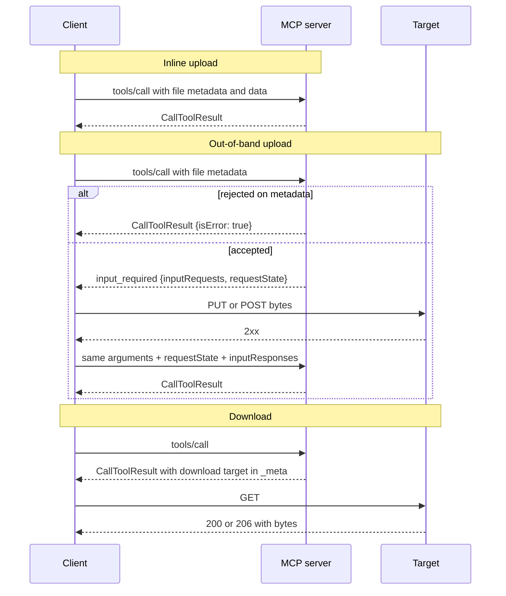

# File Uploads Extension

- **Status**: Draft
- **Extension Identifier**: `io.modelcontextprotocol/files` (provisional)
- **Working Group**: [File Uploads](https://modelcontextprotocol.io/community/working-groups/file-uploads)
- **Editors**: Den Delimarsky (@localden)
- **Discussion**: [File Uploads Working Group Discord thread](https://discord.com/channels/1358869848138059966/1551968557292593172/1552399008440520865)
  and issues in this repository

The working group plans to submit this document as an Extensions Track SEP once a reference
implementation exists. Anything here can change before then, including the extension identifier.

## Abstract

This extension defines how MCP clients transfer files to and from tools over HTTPS. Files
transferred out of band do not enter model context or JSON-RPC messages.

A client has two options for uploading a file:

- **Inline**: The client sends a small file in the tool call.
- **Out of band**: The client calls the tool with the file's metadata. The server either returns an
  upload target or rejects the call based on the metadata. If the server returns a target, the client
  uploads the bytes and retries the call.

To download a file, the client fetches it from a download target that the tool lists in its result.

## Specification

This revision applies to tools. Resource behavior is unchanged from the base protocol.

### Terms

- **Client**: The component that sends MCP requests to the next hop. A host behind a gateway is a
  client of the gateway, and the gateway is a client of the server.
- **Host**: The application that presents the model and the user interface.
- **MCP address**: The URL a client sends MCP requests to. This URL can vary per hop and can differ
  from the server's canonical URI.
- **Target**: The URL or path to which a client sends file bytes, or from which it fetches them.
- **Logical call**: An initial `tools/call` request and its retries.

In [Transfer](#transfer), [Downloads](#downloads), and [Targets](#targets), client means the
component that performs the transfer.

### Capabilities

The extension identifier is `io.modelcontextprotocol/files`.

Clients **MUST** declare the extension in the `io.modelcontextprotocol/clientCapabilities` metadata
of every request that may need it:

```json
{ "extensions": { "io.modelcontextprotocol/files": { "upload": {}, "download": {} } } }
```

Servers advertise the extension in the `server/discover` response:

```json
{
  "capabilities": {
    "tools": {},
    "extensions": {
      "io.modelcontextprotocol/files": {
        "upload": {},
        "download": {},
        "maxInlineBytes": 1048576
      }
    }
  }
}
```

The settings object has the following fields:

- `upload` _(optional)_: The sender supports out-of-band uploads.
- `download` _(optional)_: The sender supports out-of-band downloads.
- `maxInlineBytes` _(optional, servers only)_: The largest total decoded size of inline `data`
  values the server accepts in one request. If `0` or absent, the server does not accept inline
  transfer.

If `upload` or `download` is absent, the sender does not support that direction. Receivers **MUST**
ignore fields they do not recognize.

Clients:

- **MUST NOT** use this extension with a server that did not advertise it.
- **MUST NOT** send a request whose inline `data` exceeds `maxInlineBytes` in total.
- **MUST** omit `data` from every file argument if the server does not accept inline transfer.
- **MUST NOT** send a file out of band to a server that did not advertise `upload`.

A server that accepts inline `data` **MUST** advertise `maxInlineBytes`. A server that does not
accept inline transfer and advertises `upload` requires an upload round trip for every file,
regardless of size.

For example, a server with a `maxInlineBytes` of 1 MiB and a file argument with a `maxSize` of 150
MiB accepts a 200 KiB file or two 400 KiB files inline in one request, accepts a 40 MiB file out of
band, and rejects a 200 MiB file based on its metadata.

### Flow

A client sends a file inline or out of band. A tool returns a file through a download target.



### File Arguments

A server marks a file argument by adding `x-mcp-file` directly to the argument's object schema in
`Tool.inputSchema`. This behavior is consistent with
[`x-mcp-header`](https://modelcontextprotocol.io/specification/draft/server/tools#x-mcp-header).
Unlike `x-mcp-header`, `x-mcp-file` applies to objects and can appear in array items. Servers
**MUST** make the marked schema require the `FileInput` shape.

```typescript
/** The value of x-mcp-file. */
interface FileInputDescriptor {
  /** Media types or dot-prefixed extensions for a file picker. Servers can reject a file by type. */
  accept?: string[];
  /** Maximum decoded size of each file in bytes, for inline and out-of-band transfer. */
  maxSize?: number;
}

interface FileInput {
  /** Unique within this tool call. */
  id: string;
  name?: string;
  /** "application/octet-stream" if unknown. */
  mimeType: string;
  /** Non-negative integer; decoded size in bytes. */
  size: number;
  /** SHA-256 over the original bytes. */
  digest: { algorithm: "sha-256"; value: string /* base64url, no padding */ };
  /**
   * RFC 4648 base64-encoded file bytes. If absent and size is greater than 0, the client requests
   * an out-of-band upload.
   */
  data?: string;
}
```

This can be represented in a server's schema as follows:

```json
{
  "name": "save_to_folder",
  "inputSchema": {
    "type": "object",
    "properties": {
      "folderId": { "type": "string" },
      "file": {
        "type": "object",
        "x-mcp-file": { "accept": ["application/pdf"], "maxSize": 157286400 },
        "properties": {
          "id": { "type": "string" },
          "name": { "type": "string" },
          "mimeType": { "type": "string" },
          "size": { "type": "integer", "minimum": 0 },
          "digest": {
            "type": "object",
            "properties": {
              "algorithm": { "const": "sha-256" },
              "value": { "type": "string" }
            },
            "required": ["algorithm", "value"]
          },
          "data": { "type": "string" }
        },
        "required": ["id", "mimeType", "size", "digest"]
      }
    },
    "required": ["folderId", "file"]
  }
}
```

Clients **MUST** make each `id` unique within the call. Servers **MUST** validate the decoded size
and digest before using the bytes.

A file with `size` 0 has no bytes to transfer. Clients **MUST** omit `data` for it. Servers **MUST**
treat it as an empty file, **MUST** check its `digest`, and **MUST NOT** issue a target for it.

Clients that do not support this extension ignore the keyword. Validators that reject unknown
keywords by default, such as Ajv in strict mode, require configuration to allow `x-mcp-file`.

Hosts:

- **SHOULD NOT** show `x-mcp-file` properties to a model that emits arguments as tokens.
- **MAY** instead show the model a substitute parameter whose value is a host-defined handle, and
  replace the handle with a `FileInput` before sending the call.
- **MUST** bind a file to an argument only on the user's selection or under the host's approval
  policy for model-supplied values.
- **MUST NOT** place file bytes or upload URLs in model context.

The host rules above apply to any file the host can read, including a file an agent created.

A tool whose text argument can refer to files, such as Markdown with image links, **SHOULD** accept
a separate array of file arguments and document the relationship in its description. This extension
does not define how a host presents a result to the model.

### Uploads

#### Initial Call

The client sends `tools/call` with every argument populated, and omits `data` for each file it will
upload out of band. The request examples omit the `_meta` request metadata. Every request **MUST**
include the required
[`_meta`](https://modelcontextprotocol.io/specification/draft/basic/index#meta) fields; see also
[Capabilities](#capabilities).

```json
{
  "jsonrpc": "2.0",
  "id": 1,
  "method": "tools/call",
  "params": {
    "name": "save_to_folder",
    "arguments": {
      "folderId": "fld_8c1a",
      "file": {
        "id": "file-1",
        "name": "Q3 report.pdf",
        "mimeType": "application/pdf",
        "size": 41204133,
        "digest": {
          "algorithm": "sha-256",
          "value": "uU0nuZNNPgilLlLX2n2r-sSE7-N6U4D6ZVe-_rYh2sU"
        }
      }
    }
  }
}
```

Before this call, the host **MUST** obtain the user's approval to send the file to this server and
to storage the server designates, or apply operator policy when no user is present.

Servers **SHOULD** perform every check that does not require the bytes, such as destination
authorization, quota, `accept`, and `maxSize`, and return a `CallToolResult` with `isError: true` if
one fails. Servers **MUST** treat the metadata as client-asserted and re-check size, digest, and
type once the bytes arrive.

The tool determines whether an existing file with the same name is a conflict. A tool that supports
conditional writes accepts the revision or condition as a tool argument.

#### Upload Request

If the server accepts the files, it returns an `InputRequiredResult` with an upload input request
under `inputRequests.uploads`. This method needs a core MRTR extension point, because the
input-request and input-response unions are closed. The fixed `uploads` key also differs from core
MRTR, where keys are server-assigned.

```json
{
  "jsonrpc": "2.0",
  "id": 1,
  "result": {
    "resultType": "input_required",
    "inputRequests": {
      "uploads": {
        "method": "io.modelcontextprotocol/files/upload",
        "params": {
          "files": [
            {
              "fileId": "file-1",
              "url": "https://upload.example.com/u/01JD3V7K2M?sig=...",
              "headers": {
                "Content-Type": "application/pdf",
                "x-amz-checksum-sha256": "uU0nuZNNPgilLlLX2n2r+sSE7+N6U4D6ZVe+/rYh2sU="
              },
              "credentials": "omit",
              "expiresAt": "2026-11-04T18:30:00Z"
            }
          ]
        }
      }
    },
    "requestState": "..."
  }
}
```

```typescript
interface UploadInputRequest {
  method: "io.modelcontextprotocol/files/upload";
  params: { files: UploadTarget[] };
}

interface UploadTarget {
  /** The corresponding FileInput.id in the original arguments. */
  fileId: string;
  /** Absolute https URL. Exactly one of url and path is present. */
  url?: string;
  /** Path under the MCP address. Exactly one of url and path is present. */
  path?: string;
  /** Defaults to "PUT". */
  method?: "PUT" | "POST";
  /** Sends the file as multipart/form-data. Requires method "POST". */
  form?: UploadForm;
  /** Headers the client sends with the transfer. */
  headers?: { [name: string]: string };
  /**
   * "omit": the target carries its own authorization. "include": the client attaches its MCP
   * credential. Valid only on a path target.
   */
  credentials: "omit" | "include";
  /** ISO 8601 timestamp. Advisory latest start time for the transfer. */
  expiresAt?: string;
}

interface UploadForm {
  /** Fields the client sends before the file, in array order. */
  fields: { name: string; value: string }[];
  /** Name of the form field that carries the file. */
  fileField: string;
}
```

A storage API that accepts only `multipart/form-data` uses a `form` target:

```json
{
  "fileId": "file-1",
  "url": "https://upload.example.com/",
  "method": "POST",
  "form": {
    "fields": [
      { "name": "key", "value": "staging/01JD3V7K2M" },
      { "name": "policy", "value": "..." },
      { "name": "signature", "value": "..." }
    ],
    "fileField": "file"
  },
  "credentials": "omit",
  "expiresAt": "2026-11-04T18:30:00Z"
}
```

Servers:

- **MUST** return an upload input request only on `tools/call`, and only to a request that declared
  `upload`.
- **MUST** make each `fileId` match one non-empty file argument without `data`.
- **MUST NOT** give a file more than one outstanding target in a round.
- **MUST** return the upload input request before creating a task, if they use the [Tasks
  extension](https://modelcontextprotocol.io/extensions/tasks/overview).
- **MUST** bind the tool name, all arguments, each file's current target, and the authenticated
  principal, if any, to `requestState`.
- **MUST NOT** allow a target to remain valid after the latest `requestState` it was issued under
  expires.

Servers **MUST** handle `requestState` as the [MRTR server
rules](https://modelcontextprotocol.io/specification/draft/basic/patterns/mrtr#server-requirements-basic-workflow)
require. Clients **MUST** handle `requestState` as the [MRTR client
rules](https://modelcontextprotocol.io/specification/draft/basic/patterns/mrtr#client-requirements-basic-workflow)
require for `InputRequiredResult`. MRTR recommends a short `requestState` expiry. A server issuing
targets for large files **SHOULD** choose a `requestState` lifetime that covers a transfer started
at `expiresAt`, plus the retry.

#### Transfer

The client checks the target against [Targets](#targets), then sends the file to the target's `url`
or resolved `path`, with `method` and `headers`. Without `form`, the file bytes are the request
body. With `form`, the body is `multipart/form-data` as defined in [RFC
7578](https://www.rfc-editor.org/rfc/rfc7578). A `2xx` response indicates success.

Clients:

- **MUST** support `form` targets if they declare `upload`.
- **MUST** send each entry in a `form` target's `fields` as one part, in array order, then send the
  file as the last part, named `fileField`. The file part's `filename` is the base name of
  `FileInput.name`, or `file` if `name` is absent. Its `Content-Type` is `FileInput.mimeType`.
- **MUST NOT** send more file bytes than the declared `size`.
- **SHOULD NOT** start a transfer after `expiresAt`, and **MUST** report that file as `failed` if
  they do not start it. The target decides whether to accept a transfer.
- **MUST** bound transfer attempts per file per logical call. Each request sent to a target is an
  attempt, including a request that answers a repeated upload input request.
- **MUST** report the file as `failed` on the retry after reaching that bound, and **MUST** stop
  before it if a failure is permanent or a further attempt is unsafe.
- **MUST NOT** automatically resend a `POST` unless they know the request did not reach the target.
  A transfer that answers a repeated upload input request is not a resend.
- **MUST** complete the upload and retry without returning control to the model.
- **SHOULD** send the retry with status `failed` if the user cancels.

Servers **SHOULD NOT** echo upload URLs in the `CallToolResult`. Servers that issue `omit` targets
to browser clients **SHOULD** configure the storage to respond to the CORS preflight request for the
listed headers.

#### Retry

When retrying, the client **MUST** send a new JSON-RPC `id`, the same tool name and exact arguments,
the exact `requestState`, and one outcome per requested file under `inputResponses.uploads`:

```json
{
  "jsonrpc": "2.0",
  "id": 2,
  "method": "tools/call",
  "params": {
    "name": "save_to_folder",
    "arguments": {
      "folderId": "fld_8c1a",
      "file": {
        "id": "file-1",
        "name": "Q3 report.pdf",
        "mimeType": "application/pdf",
        "size": 41204133,
        "digest": {
          "algorithm": "sha-256",
          "value": "uU0nuZNNPgilLlLX2n2r-sSE7-N6U4D6ZVe-_rYh2sU"
        }
      }
    },
    "inputResponses": {
      "uploads": {
        "files": [{ "fileId": "file-1", "status": "completed" }]
      }
    },
    "requestState": "..."
  }
}
```

```typescript
interface UploadInputResponse {
  files: { fileId: string; status: "completed" | "failed" }[];
}
```

`status` is `completed` if the client observed a successful transfer, and `failed` otherwise. A file
with status `failed` ends the logical call. Clients **MUST NOT** include upload URLs or credentials
in the response.

On a retry that answers an upload input request, the server **MUST** perform these steps in order,
and **MUST** respond as [Errors](#errors) specifies when a step fails:

1. Verify `requestState`.
2. Check the tool name and arguments against the values bound in `requestState`.
3. Check each `fileId` and status. If any file has status `failed`, stop without running the tool.
   If an outcome is missing, follow [MRTR error
   handling](https://modelcontextprotocol.io/specification/draft/basic/patterns/mrtr#error-handling)
   and do not run the tool.
4. Confirm with the storage backend that each file's bytes arrived, for example with a `HEAD`
   request or a session status query. Verify `digest`, and re-check size and type. The server
   **MUST NOT** run the tool with bytes it has not confirmed.
5. If running the tool twice is unsafe, claim `requestState` as specified in [Repeated
   Retries](#repeated-retries). If it is already claimed, follow that section.
6. Perform any finalize step the backend needs, run the tool, and return its result.

If the bytes have not arrived at step 4, the server **MAY** return another `InputRequiredResult`
with a new `requestState` and a new or reissued target. It is not required to wait for the bytes to
become visible first. A repeated upload input request can require a full re-upload, including when
the bytes arrived but the backend had not yet made them visible.

The echoed `requestState` and `fileId` identify the current target. A new round requires a new
`requestState`, and a server **MAY** reissue the same target under it. If the server issues a
different target, it **MUST** prevent the old target from satisfying the new round. A server that
issues a later round **MUST** bind confirmed files to the new `requestState`, and **MUST NOT** ask
for their outcome again. Servers **MUST NOT** use a target for a different call.

#### Repeated Retries

A client can repeat a retry if it does not receive the response.

The upload flow is stateless by default. Each retry carries what the server needs in the request
and in `requestState`, and any instance can process it. A tool that is safe to run twice, such as
one that is idempotent on `digest` and its arguments, needs no claim. The server runs it again on a
repeated retry, and treats a file it already finalized as confirmed at step 4.

A tool that is unsafe to run twice needs a `requestState` that works only once. [MRTR leaves that to
the
server](https://modelcontextprotocol.io/specification/draft/basic/patterns/mrtr#server-requirements-basic-workflow).
Before running such a tool, the server **MUST** claim the `requestState` atomically, using storage
every instance shares. A claimed `requestState` counts as processed, even while the tool is running.

A server that receives a claimed `requestState` **MUST NOT** run the tool again. While the tool is
running, the server **MUST** return an `InputRequiredResult` with the same `requestState` and no
`inputRequests`. After the tool finishes, the server **MUST** return the original result to the same
principal, or the `already_processed` error. A tool that can outlast a client or gateway timeout
**SHOULD** use the [Tasks extension](https://modelcontextprotocol.io/extensions/tasks/overview).

A client that receives such an `InputRequiredResult` repeats the same retry. Clients **MUST** wait
between repeats and **MUST** bound their number. A client that reaches that bound treats the outcome
as unknown.

A gateway can repeat a retry, and **MUST** pass `already_processed` through unchanged.

A client that receives `already_processed`, or whose repeated retry fails `requestState`
verification, **MUST NOT** treat the response as proof that the call failed, and **MUST NOT** repeat
the call automatically. The outcome of the earlier attempt is unknown.

#### Staging

Servers **SHOULD** issue targets that write to a staging location and that enforce the declared
size.

Staged bytes are application data that `requestState` refers to. They are not protocol session
state. Servers manage their lifetime and cleanup, for example with storage-side expiry. Servers:

- **MUST** keep staged bytes until the latest `requestState` bound to them expires, the call ends,
  or their target is replaced, whichever comes first.
- **MUST NOT** expose a staged file as finished until they confirm it on the retry.
- **MUST** allow any instance that receives the retry to confirm the staged bytes.
- **SHOULD** prevent further writes through a target before verifying its bytes, and **SHOULD**
  finalize the bytes they verified.

A target that writes to the final destination creates the file before the server confirms it.
Servers **SHOULD NOT** issue such a target unless the backend enforces the declared size and digest
on the write, and the write cannot replace existing content. If a later check fails, the client
reports `failed`, or no retry arrives before the `requestState` expires, the server **MUST** remove
the file. Storage-side expiry can do this without tracking the call.

### Downloads

> **Note**: The working group has not reviewed this section yet.

A tool returns files by listing them in the `_meta` of its `CallToolResult`, under the extension
identifier, with one entry per file. The server **MUST** also describe the result in `content`:

```json
{
  "jsonrpc": "2.0",
  "id": 3,
  "result": {
    "resultType": "complete",
    "content": [{ "type": "text", "text": "Exported q3-orders.csv." }],
    "_meta": {
      "io.modelcontextprotocol/files": {
        "downloads": [
          {
            "id": "export-1",
            "name": "q3-orders.csv",
            "mimeType": "text/csv",
            "size": 209715200,
            "url": "https://download.example.com/d/01JD3V9P4Q?sig=...",
            "credentials": "omit",
            "expiresAt": "2026-11-04T18:30:00Z"
          }
        ]
      }
    }
  }
}
```

```typescript
interface ResultFilesMeta {
  downloads: DownloadTarget[];
}

interface DownloadTarget {
  /** Unique within this result. */
  id: string;
  name?: string;
  /** "application/octet-stream" if unknown. */
  mimeType: string;
  /** Non-negative integer; size in bytes, after any Content-Encoding is removed. */
  size?: number;
  /** SHA-256 over the whole file, after any Content-Encoding is removed. */
  digest?: { algorithm: "sha-256"; value: string /* base64url, no padding */ };
  /** url, path, credentials, and expiresAt have the same meaning as in UploadTarget. */
  url?: string;
  path?: string;
  /** Headers the client sends with the `GET`. */
  headers?: { [name: string]: string };
  credentials: "omit" | "include";
  expiresAt?: string;
}
```

Servers:

- **MUST** add a download target only to the result of a call whose `tools/call` request declared
  `download`, however that result is delivered.
- **MUST NOT** list a target until the file can be fetched. This extension does not define how a
  tool waits for a file to exist.
- **SHOULD** include `size` when they know it.

The client sends a `GET` to the target's `url` or resolved `path` with `headers`. A `200` response,
or a `206` response to a range request, indicates success. Clients **MAY** use range requests to
split or resume a download.

Clients:

- **MUST** check `size` and `digest`, if present, after receiving the whole file, and **MUST**
  discard a file that fails a check.
- **MUST** treat `name`, `mimeType`, `size`, and the bytes as untrusted.
- **MUST NOT** use `name` as a filesystem path without reducing it to a safe base name.
- **MUST** abort once the decoded bytes exceed `size`, and **SHOULD** apply their own limit when
  `size` is absent.
- **SHOULD NOT** start a download after `expiresAt`.
- **SHOULD** fetch a file they want before returning control to the model, if user or operator
  policy permits. A target cannot be renewed.
- **MUST NOT** repeat the call automatically. A repeated call runs the tool again.

Hosts **MUST NOT** place download targets in model context.

Servers can return small files as embedded resources, as defined in the base protocol.

### Targets

These rules apply to every upload and download target.

Clients **MUST** reject a target if:

1. It does not have exactly one of `url` and `path`.
2. Its `url` is not an absolute `https` URL.
3. Its `path` does not match `1*( "/" segment )`, where `segment` is one or more ASCII letters,
   digits, `-`, `_`, `~`, or `.`, and is neither `.` nor `..`.
4. Its `credentials` is missing or unrecognized, or its `method` is unrecognized.
5. Its `headers` include `Authorization`, `Cookie`, a [forbidden request
   header](https://fetch.spec.whatwg.org/#forbidden-request-header), or a name or value that is not
   valid under [RFC 9110](https://www.rfc-editor.org/rfc/rfc9110#section-5).
6. It is a `path` target and its `headers` include `Forwarded`, `X-Original-URL`, `X-Rewrite-URL`,
   `X-HTTP-Method-Override`, or a name that starts with `X-Forwarded-`.
7. It has `form`, and its `method` is not `POST` or its `headers` include `Content-Type`.
8. Its `form` has an empty `fileField` or field `name`.
9. Its `form` has a `fileField`, field `name`, or field `value` that contains a CR, LF, or NUL
   character.

#### Credentials

`credentials: "include"` is valid only on a `path` target. A `path` resolves under the MCP address,
so the credential stays within the server it was issued for. Clients **MUST** reject a `url` target
with `credentials: "include"`.

#### Addresses

Clients **MUST** check the address they connect to, and **MUST NOT** connect to one the [IANA
special-purpose registries](https://www.rfc-editor.org/rfc/rfc6890) mark as not globally reachable,
unless an operator allowlist permits it or the target is a `path`. A client that cannot observe the
address, such as a browser or a client behind a forward proxy, **MUST** rely on a platform or proxy
mechanism that enforces the same restriction, or **MUST** reject `url` targets not on an operator
allowlist. Hosts **MAY** restrict `omit` targets to an allowlist of origins.

#### Redirects

Servers **SHOULD** issue targets that respond without a redirect. Clients **MUST NOT** follow
redirects, and **MUST** treat a `3xx` response as a failed transfer.

#### Resolving `path`

A client resolves a `path` by appending it to the path of the MCP address, without a doubled `/` and
before any query string. With the MCP address `https://gateway.example.com/mcp/abc`, `/uploads`
resolves to `https://gateway.example.com/mcp/abc/uploads`. A `path` target inherits the scheme of
the MCP address. Clients **MUST** reject a `path` target over `http`, except on loopback.

#### stdio

Servers on stdio **MUST** issue only `url` targets with `credentials: "omit"`. The stdio transport
has no canonical URI or MCP address.

### Gateways

The component that holds the bytes performs the transfer.

A gateway **MAY** replace a target's `url` or `path`, `method`, `form`, `headers`, and `credentials`
with a relay at its own origin.

A gateway that relays an upload **MUST**:

- Check the original target against [Targets](#targets).
- Forward the bytes with the original target's `method`, `form`, `headers`, and `credentials`,
  resolving a `path` against the address it uses for the server.
- Accept bytes only from the caller.

The relay **MUST NOT** answer `2xx` until the original target has.

A gateway that relays a download **MUST** check the original target against [Targets](#targets),
fetch the bytes from it with the original target's `headers` and `credentials`, resolving a `path`
against the address it uses for the server, and serve them only to the caller. The relay
**MUST NOT** answer `2xx` until the original target has.

A gateway that presents more than one server at one MCP address **MUST** replace every `path`
target. Any other gateway that passes a `path` target through unchanged **MUST** route everything
under that MCP address to that one server, **MUST NOT** forward the caller's credential upstream,
and **MUST** attach its own credential for the server when the target has `credentials: "include"`.

### Errors

Servers **MUST** respond to the following conditions as shown. The `requestState`, `fileId`, status,
and bytes conditions apply to a retry that answers an upload input request. `isError: true` means a
`CallToolResult` with `isError` set to `true`. `-32021` is
[`MissingRequiredClientCapabilityError`](https://modelcontextprotocol.io/specification/draft/schema#missingrequiredclientcapabilityerror).

| Condition                                                                            | Response                                                                                             |
| ------------------------------------------------------------------------------------ | ---------------------------------------------------------------------------------------------------- |
| Inline `data` exceeds `maxInlineBytes` in total, or the server does not accept it    | JSON-RPC `-32602`, reason `inline_too_large`                                                         |
| Non-empty file omits `data`, server has `upload`, request did not declare it         | `-32021` with `data.requiredCapabilities` listing the missing capability                             |
| Server knows the tool can only return a download, request did not declare `download` | `-32021` as above, before running the tool                                                           |
| Server cannot accept a file inline or out of band                                    | `isError: true`                                                                                      |
| Inline data cannot be decoded, or fails the size or digest check                     | `isError: true`                                                                                      |
| Duplicate `id` values in file arguments                                              | JSON-RPC `-32602`                                                                                    |
| `requestState` fails verification                                                    | JSON-RPC `-32602`                                                                                    |
| Tool name or arguments differ from `requestState`                                    | JSON-RPC `-32602`                                                                                    |
| Duplicate or unknown `fileId`, or unknown status                                     | JSON-RPC `-32602`                                                                                    |
| A file has status `failed`                                                           | `isError: true`, without running the tool                                                            |
| Bytes have not arrived, and the server does not start a new round                    | `isError: true`, without running the tool                                                            |
| Bytes arrived but fail a check                                                       | `isError: true`, without running the tool                                                            |
| `requestState` already claimed, and the tool has finished                            | Original result to the same principal, or JSON-RPC `-32602`, reason `already_processed`              |

The error's `data` carries the reason under the extension identifier:

```json
{
  "code": -32602,
  "message": "Invalid params",
  "data": { "io.modelcontextprotocol/files": { "reason": "already_processed" } }
}
```

`inline_too_large` is an exception to
[SEP-1303](https://modelcontextprotocol.io/seps/1303-input-validation-errors-as-tool-execution-errors).
A client that receives this error **MAY** repeat the call without `data` if it declared `upload` and
the server advertised it.

## Backward Compatibility

This extension is optional. A client that does not declare it never receives an upload input request
or a download target. Tools that accept file content inline today, such as base64 strings, continue
to work, as they do not depend on the upload or download flows. A tool that adopts `x-mcp-file`
changes its `inputSchema`, so a client without this extension sees an object argument it cannot
populate correctly.

SDKs require an MRTR extension point to support the upload input request.

## Security Implications

Clients and servers **MUST** redact target URLs, target headers, `form` fields, and inline
`data` in logs, traces, and error reports.

### Server-Directed Requests

A client that does not enforce [Targets](#targets) is exposed to server-side request forgery and can
leak the user's credential. Operators **SHOULD NOT** enable this extension behind a gateway that
does not implement it. Such a gateway cannot meet the rules in [Targets](#targets).

### Exfiltration

A malicious server can specify any public URL as an `omit` target and receive the file at that URL.
`POST` reaches more existing endpoints than `PUT`, and `form` also reaches HTML form handlers. The
host approval required before the initial call mitigates this risk and applies to agent-created
files. A compromised agent can write sensitive data to a file and try to send it.

### Binding

Binding the principal, tool name, arguments, and upload targets to `requestState` prevents a client
from uploading under one call's authorization and attaching the file to another call or destination.
The required digest lets the server detect bytes replaced through an `omit` URL before it uses them.

### Writable Targets

A target that remains writable after verification lets anyone holding it replace the file.
Pre-signed URLs often cannot be revoked. Servers that use them rely on short lifetimes or finalize a
copy of the verified bytes.

### Secret URLs

A URL that carries its own authorization is a secret for as long as it is valid. Servers **SHOULD**
issue such URLs with the shortest lifetime that covers the expected transfer.

### Staged Files

User files remain in staging until the server or storage-side expiry removes them.

### File Contents

Servers **SHOULD** follow [OWASP ASVS 5.0
V5](https://github.com/OWASP/ASVS/blob/v5.0.0/5.0/en/0x14-V5-File-Handling.md) for the formats they
accept.

## Reference Implementation

The reference implementation will include a TypeScript SDK branch with the upload input request and
a client transfer helper, a reference server in front of an object store, and conformance scenarios
for inline transfer, out-of-band transfer, a `form` target, rejection on metadata, a failed
upload, a digest mismatch, a repeated retry, and a download.

## Open Questions

1. **MRTR extensibility.** How should the specification enable extension-defined input requests?
   Repeated retries may belong in the same change. That change should also allocate a core error
   code for an already-processed `requestState`, because extensions cannot use the reserved range.
   This extension would then replace `already_processed` with that code.
2. **Finalize.** Some backends return a commit handle in the transfer's HTTP response, such as an
   ETag or block ID, and the retry has no field for it. Owners of backends with an explicit commit
   step are asked to confirm whether finalizing on the retry works. An optional per-file field in
   `UploadInputResponse` can be added if needed.
3. **Tools behind an executor.** Gateways that expose a single generic tool hide the inner tool's
   schema, including `x-mcp-file`. The executor could declare its own file argument and map it to
   the inner call. The group needs to answer this before the extension leaves the experimental
   phase.
4. **Resources.** Should a later revision apply this flow to resources?

## Future Work

- **Chunked and resumable uploads**, for backends with per-request size limits and for interrupted
  transfers, once a standard is established.
- **Elicitation forms.** Out-of-band upload for `x-mcp-file` fields in `elicitation/create`.
- **More authorization methods**, including storage that needs a credential separate from the MCP
  one, and HTTP Message Signatures.
- **Promotion to the specification**, after the group has validated the extension in use.

## Acknowledgments

This draft builds on
[SEP-2356](https://github.com/modelcontextprotocol/modelcontextprotocol/pull/2356) and
[SEP-2631](https://github.com/modelcontextprotocol/modelcontextprotocol/pull/2631), and on
collaboration in the
[File Uploads Working Group](https://modelcontextprotocol.io/community/working-groups/file-uploads)
and review from implementers.
